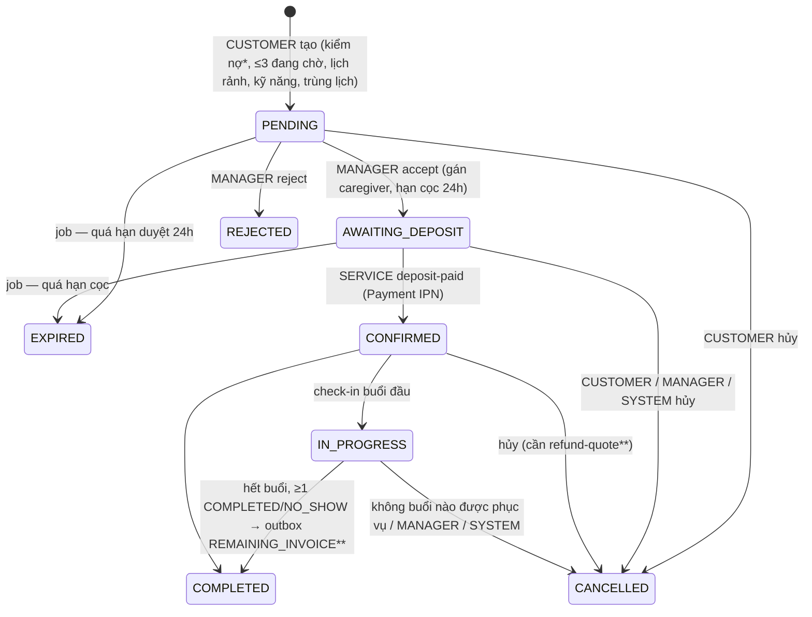
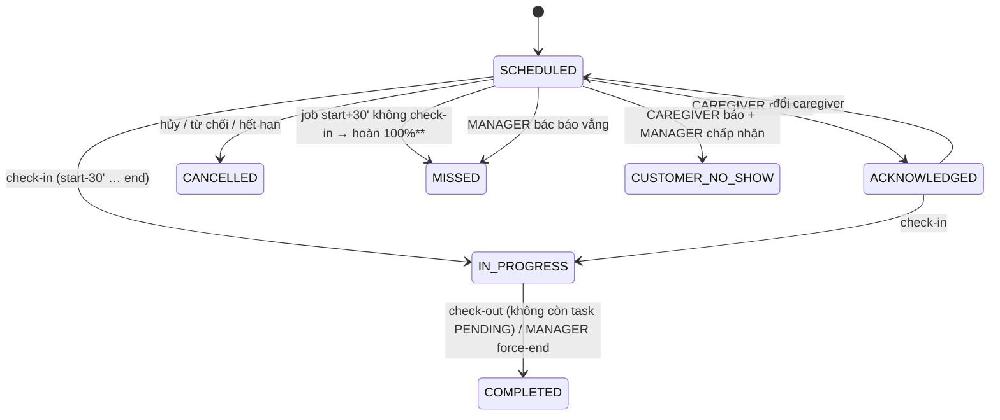
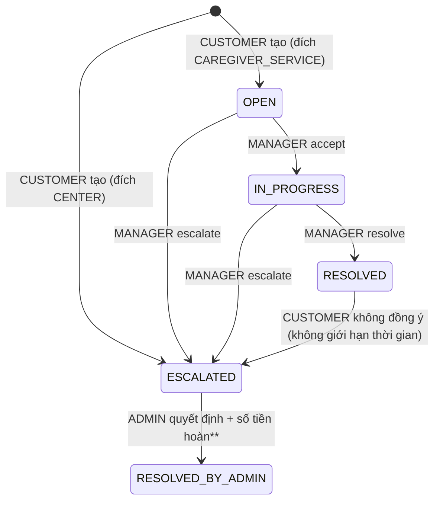

# CareConnect — Khảo sát & phân tích kẽ hở nghiệp vụ toàn hệ thống (BE + FE)

> Ngày khảo sát: **2026-10-28** · BE `dev` @ `61b3f51` · FE `dev` @ `275d7ed` (rà lại sau pull, xem §0) · Chỉ đọc code, **chưa sửa code**.
> Tài liệu này thay thế phần "hiện trạng" của `docs/GAP_ANALYSIS.md` (2026-10-21) — phần lớn SEC-xx, Booking, hậu mãi đã
> được làm từ ngày đó; các quyết định D1–D14 và bảng phí hủy §1.2 của tài liệu cũ **vẫn là nguồn sự thật nghiệp vụ**.
> Đường dẫn viết tắt: `BK/` = `BookingService/src/main/java/mss301/bookingservice/`, `PS/` = PaymentService, `PV/` = Provider,
> `CC/` = CareCatalog, `CR/` = CareRecipient, `ID/` = Identity, `GW/` = ApiGateway, `FE/` = `../FE-careconnect/app/`.

**Kết luận nhanh**

- Backend Booking, hậu mãi, Provider, Catalog, Identity, CareRecipient **đã khá hoàn chỉnh** (đủ state machine, outbox,
  scheduler, phân quyền theo dữ liệu, ~330 test pass).
- **PaymentService mới đạt khoảng 20–25 % WORK_PLAN_A**: chỉ có luồng tạo phiên cọc VNPay/Stripe + IPN. Toàn bộ hoàn tiền,
  hóa đơn phần còn lại, công nợ, chính sách, sổ cái, đối soát **chưa có**, trong khi **BookingService đã gọi các API đó** →
  khách **không hủy được booking đã cọc**, yêu cầu hoàn tiền/hóa đơn bị mất. Đây là lỗ hổng nặng nhất của hệ thống.
- **Secret thật của client SERVICE `booking` đã bị commit vào lịch sử FE** (phát hiện khi rà commit `275d7ed`) — cần đổi
  secret ngay (C-05, §0).
- FE đã nối thật cho booking, hồ sơ người bệnh, quản lý caregiver/ca/dịch vụ, tài khoản. **Chưa có FE** cho: care report,
  đánh giá, khiếu nại, thông báo (REST + SSE), thanh toán thật (đang dùng stub của `pnpm dev`). Nhiều màn hình Admin và
  Caregiver vẫn là **dữ liệu mẫu**, một số **không gắn nhãn mẫu** (dễ gây hiểu nhầm là số thật).

---

## 0. Cập nhật sau khi pull code mới (2026-10-28, tối)

| Repo | Thay đổi | Ảnh hưởng tới báo cáo |
|---|---|---|
| BE | **Không có commit mới** (`dev` = `origin/dev` = `61b3f51`) | Không đổi |
| FE | 1 commit `275d7ed` "fix: deposit fee for booking" (28 file, chủ yếu sinh lại client) | Xem dưới |

Nội dung commit FE `275d7ed`:

- Thêm tag `PaymentPolicy` vào snapshot (`GET /v1/payment-policies/effective`, 178 operation) — **khớp endpoint thật** của
  PaymentService (`PS/controller/PaymentPolicyController.java`). `entities/payment` thêm `useDepositAmount`: khi booking chưa có
  `depositAmount` (Booking để trống, Payment quyết định), FE **ước tính** cọc = tổng × `depositPercent` và gắn nhãn "dự kiến"
  ở chi tiết booking (khách + manager), panel trạng thái và trang đặt cọc. Có nhánh hiển thị khi chưa biết số tiền.
- Stub `scripts/payment-demo.mjs` tính cọc theo chính sách thay vì đọc `depositAmount`; thêm mã lỗi demo 6207/6208.
- `.env.example`: **xóa giá trị** `PAYMENT_DEMO_SERVICE_CLIENT_SECRET` đã commit từ `934030d` (2026-10-27).

Hệ quả cập nhật vào báo cáo:

1. **Mới — C-05 (Critical):** giá trị bị xóa chính là **secret thật của client SERVICE `booking`** (khớp `BookingService/.env`)
   và vẫn nằm trong lịch sử `origin/dev` của FE. Ai đọc được repo đều xin được token SERVICE `booking` → gọi
   `POST /bookings/{id}/deposit-paid` để **xác nhận booking mà không trả tiền**, đọc hồ sơ người bệnh qua các API SERVICE, đẩy
   thông báo tùy ý… Xóa khỏi file **không đủ**: phải **đổi secret** (sinh lại bằng `IdentityService/scripts/New-ServiceClient.ps1`,
   cập nhật `IDENTITY_SERVICE_CLIENTS` + `BOOKING_SERVICE_CLIENT_SECRET` ở mọi môi trường) và cân nhắc phân quyền token SERVICE
   theo client (M-03).
2. **C-03 giảm một phần:** 1 trong 4 op Payment của FE giờ trỏ đúng BE thật; `POST /payments/deposits` và `demo-results` **vẫn chỉ có
   ở stub dev**. Thêm: bảng mã lỗi FE (`KNOWN_ERROR_CODES` 6200–6207) là mã của **stub**, không khớp `ErrorCode` thật của
   PaymentService (6000–6013, vd 6004 = không tìm thấy giao dịch) → khi chuyển sang Payment thật phải đổi map lỗi.
3. **Q-03 trở nên cấp bách:** PaymentService thật trả `depositPercent` từ env, **mặc định 100**; `payment_stub.py` (e2e) trả **30**.
   Chạy với Payment thật mà không đặt `PAYMENT_DEPOSIT_PERCENT=30` thì FE sẽ hiển thị "cọc dự kiến" bằng **toàn bộ** tổng tiền.
   Ngoài ra số FE ước tính (tổng × %) có thể lệch số Payment thật thu (Payment chụp % lúc tạo phiên đầu tiên, không phân bổ theo
   buổi) — chấp nhận được vì đã gắn nhãn "dự kiến" và trang cổng thanh toán hiển thị số của phiên.
4. Kiểm tra lại sau pull: `pnpm lint` ✅, `pnpm typecheck` ✅, `vitest` các thư mục bị đổi (payment, bookings, manager booking,
   entities) 20 file / 66 test ✅, `node --test scripts/*.test.mjs` 10/10 ✅. BE không đổi nên không chạy lại.

---

## 1. Tổng quan stack & kiến trúc

### 1.1 Backend (`BE/`)

| Hạng mục | Hiện trạng |
|---|---|
| Ngôn ngữ / framework | Java 21, Spring Boot 4.1.1, Spring Cloud (Gateway Server MVC, OpenFeign, Resilience4j) |
| Kiến trúc | 8 microservice độc lập (mỗi service một Maven project, DB PostgreSQL riêng), gọi nhau **qua ApiGateway** bằng Feign; layer `controller → service (interface) → service/Impl → repository`, MapStruct, `APIResponse<T>`, `AppException` + `ErrorCode` theo dải mã |
| Service | ApiGateway 8080 · Identity 8081 (+Redis) · CareRecipient 8082 · CareCatalog 8083 · Provider 8084 · Booking 8085 · Media 8086 (R2) · Payment 8087 |
| Auth | Identity phát JWT RS256 + JWKS; web dùng cookie HttpOnly + CSRF, mobile bearer; token SERVICE (client-credentials) cho gọi máy–máy; mọi service là OAuth2 Resource Server và tự `@PreAuthorize` + kiểm phạm vi dữ liệu |
| Schema | SQL áp tay `schema/*.sql` + `schema/changes/`, `ddl-auto: validate`, không Flyway |
| Bất đồng bộ | Outbox bảng riêng ở Booking và Provider (SKIP LOCKED + lease + retry backoff), `@Scheduled` cho hết hạn / MISSED / nhắc ca / quá giờ phiên; SSE thông báo (in-memory, một instance) |
| Test baseline 2026-10-28 | `mvnw test` **pass ở cả 8 service** (Identity 89, CareRecipient ~73, Catalog 17, Provider 61, Booking ~99, Media 10, Gateway 20, Payment 1) |

### 1.2 Frontend (`FE-careconnect/`)

| Hạng mục | Hiện trạng |
|---|---|
| Stack | React 19, React Router 8 framework mode **SPA**, Vite 8, Tailwind 4, TanStack Query 5, Orval 8 (client + Faker + MSW sinh từ `openapi/openapi.yaml`), i18next vi/en, Vitest |
| Cấu trúc | `routes → features (theo portal) → entities → shared`; portal guard theo role ở layout; mọi chuỗi UI qua i18n (ESLint rule riêng) |
| Contract | Snapshot 178 operation / 25 tag (sau `275d7ed`); FE dùng 118 operation từ màn hình, **58 operation chưa dùng** (§4.1) |
| Design system | `shared/ui` chỉ có 5 primitive (icon, language-switch, local-file-preview, section-card, site-footer); token màu Material-3 trong `app.css` (primary `#006b2c`), font Plus Jakarta Sans; portal Customer dùng **bảng màu hex riêng** (`#075b31`…) ở 32 file |
| Baseline 2026-10-28 | `pnpm lint` ✅, `pnpm typecheck` ✅ (cảnh báo React Router cần Node ≥ 22.22, máy đang 22.19), `vitest` ✅ 75 file / 290 test |

---

## 2. Vai trò và chức năng theo vai trò

Role code (`ID/enums/RoleCode.java`): `CUSTOMER`, `CAREGIVER`, `CENTER_MANAGER`, `ADMIN` (+ `SERVICE` chỉ cho token máy, không
gán được cho user). Permission Identity: `user:read`, `user:manage`, `manager:create`, `caregiver:create`, `role:manage`.
Các service khác phân quyền theo role + phạm vi dữ liệu (chủ sở hữu / cùng `center_id` / caregiver được giao).

### 2.1 CUSTOMER — người thân

| Nhóm | Màn hình FE (route) | API BE | Ghi chú |
|---|---|---|---|
| Tài khoản | `/register`, `/login`, `/forgot-password`, `/customer/my-profile`, `/account/security` | `/auth/**`, `/users/me` | Đủ |
| Hồ sơ người bệnh | `/customer/patient-profiles`, `/new`, `/:id` | `/care-recipients/**` (thuốc, liên hệ khẩn cấp) | Đủ; **thiếu UI người thân cùng quản lý** (5 API managers chưa dùng) |
| Duyệt | `/customer/caregivers`, `/:id`, `/customer/services`, `/:offeringId` | `/caregivers`, `/caregivers/{id}/public`, `/caregivers/search`, `/catalog-items`, `/center-services`, `/price-plans`, `/care-centers/public` | BE **bắt đăng nhập** cho mọi API duyệt; FE để khách vãng lai vào → lỗi chung |
| Đặt lịch | `/customer/booking`, `/customer/bookings`, `/:id` | `/bookings/quotes`, `/bookings`, `/history`, `/cancellation-previews`, `/cancel` | Đủ phía Booking; **hủy booking đã cọc lỗi 503** do Payment (C-01) |
| Thanh toán cọc | `/customer/bookings/:id/deposit`, `/customer/payments/:id/*` | FE gọi `/payments/deposits` (**stub dev**), BE thật là `/payments/bookings/{id}/checkout`; cọc dự kiến đọc `GET /payment-policies/effective` (thật) | Lệch contract (C-03) |
| Thanh toán phần còn lại, công nợ, lịch sử giao dịch, hoàn tiền | — | BE chưa có | Thiếu cả hai đầu |
| Care report | `/customer/bookings/:code/report` (**mock, mồ côi**) | `/care-reports` (đủ) | Thiếu FE |
| Đánh giá | modal review (nút gửi `disabled`) | `/feedbacks`, `/eligible`, `/me` | Thiếu FE |
| Khiếu nại | — | `/complaints`, `/escalate` | Thiếu FE |
| Thông báo | chuông là nút chết; link `/customer/notifications` → 404 | `/notifications`, SSE `/notifications/stream` | Thiếu FE |

### 2.2 CAREGIVER — người chăm sóc (chính là app mobile; web là phụ)

| Nhóm | Màn hình FE | API BE | Ghi chú |
|---|---|---|---|
| Hồ sơ & chứng chỉ | `/caregiver/profile` | `/caregivers/me`, `/certificates/**`, `/provider-media/**` | Đủ |
| Ca làm việc (lịch rảnh) | `/caregiver/work-shifts`, `/caregiver/schedule` | `/work-shifts/**`, `/caregivers/me/schedules`, `PATCH /caregivers/schedules/{id}/status` | **Nút Bắt đầu / Hoàn thành luôn lỗi** — BE chỉ cho `CANCELLED` (`PV/service/Impl/CaregiverScheduleServiceImpl.java:91`) |
| Buổi chăm sóc | `/caregiver/visits`, `/:id` | `/booking-occurrences/**`, `/care-sessions/**` | Đủ check-in, task, check-out, báo khách vắng; **thiếu ghi chú phiên** và **tạo care report** |
| Care report | `/caregiver/shifts/:id/report` (mock, gửi `disabled`) | `/care-reports/**` (đủ) | Thiếu FE |
| Ngày nghỉ, kỹ năng | — | `/caregivers/{id}/time-offs`, `/services` | Thiếu FE |
| Dashboard, lịch sử, shift-detail, active-session | mock (2 trang **không nhãn mẫu**) | — | Trùng chức năng với `/visits` |

### 2.3 CENTER_MANAGER

| Nhóm | Màn hình FE | API BE | Ghi chú |
|---|---|---|---|
| Caregiver | `/caregivers`, `/:id` | `/users` (provision), `/caregivers/**`, `/certificates/**` | Đủ CRUD; **thiếu** đổi trạng thái, kỹ năng, ngày nghỉ, **xác minh chứng chỉ bước trung tâm** (`center-verification`) |
| Dịch vụ & giá | `/services` | `/center-services/**`, `/price-plans/**` | Không xóa/tạm dừng được offering, price plan |
| Ca làm việc | `/work-shifts`, `/:id`, `/schedules` | `/work-shifts/**`, `/care-centers/{id}/schedules` | Đủ |
| Booking | `/bookings`, `/:id` | accept/reject/cancel/đổi caregiver/no-show/force-end | Đủ; chọn caregiver **không kiểm lịch trống** |
| Đánh giá, khiếu nại cấp 1 | menu "Feedback" disabled | `/feedbacks/{id}/reply`, `/complaints/{id}/accept|resolve|escalate` | Thiếu FE |
| Thống kê | `/statistics` | `/statistics/centers` | Đủ (không có doanh thu) |
| Hồ sơ trung tâm | — | `PUT /care-centers/me` | Thiếu FE |
| Đối soát / doanh thu trung tâm | — | Payment chưa có | Thiếu cả hai |

### 2.4 ADMIN

| Nhóm | Màn hình FE | API BE | Ghi chú |
|---|---|---|---|
| Tài khoản, role | `/accounts`, `/:id`, `/roles` | `/users/**`, `/roles`, `/permissions` | Đủ |
| Trung tâm | `/centers`, `/:id/caregivers` | `/care-centers/**`, xác minh caregiver/chứng chỉ | Đủ; thiếu hàng chờ `pending-verification`, `pending-audit` |
| Danh mục dịch vụ | `/services` | `/catalog-items/**` | Đủ; thiếu `PATCH /status` |
| Dashboard | `/dashboard` | `/statistics/system`, `/care-centers/statistics` | **Biểu đồ là số mẫu không gắn nhãn** |
| Khách hàng | `/customers`, `/:id` (mock) | `/users?role=CUSTOMER`, `/users/statistics` | Có thể nối thật ngay |
| Booking, caregiver toàn hệ thống | menu disabled | `/bookings` (ADMIN đọc được) | Thiếu FE; BE không có thao tác can thiệp của admin |
| Đánh giá & khiếu nại cấp cao | `/reviews-complaints` (mock) | `/feedbacks/{id}/visibility`, `/complaints/{id}/admin-resolve` | Thiếu FE |
| Chính sách nền tảng | `/policies` (mock) | Payment chưa có PAY-02 | Thiếu cả hai |
| Doanh thu, đối soát | `/revenue` (mock) | `/payments/revenue` tối thiểu | Thiếu cả hai |
| Chất lượng caregiver | `/quality` (mock) | — | Chưa có định nghĩa nghiệp vụ |

---

## 3. Ma trận Vai trò × Chức năng × Trạng thái

Ký hiệu: ✅ Đã có đủ · 🟡 Thiếu FE · 🟠 Thiếu BE · 🔴 Lỗi · ⚪ Chưa có (cả hai) · 🧪 FE là mock

| Chức năng | CUSTOMER | CAREGIVER | CENTER_MANAGER | ADMIN |
|---|---|---|---|---|
| Đăng ký / đăng nhập / quên MK / đổi MK / phiên | ✅ | ✅ | ✅ | ✅ |
| Hồ sơ cá nhân | ✅ | ✅ (provider profile) | 🟡 (hồ sơ trung tâm) | — |
| Quản lý tài khoản, role, khóa/mở | — | — | ✅ (caregiver) | ✅ |
| Hồ sơ người bệnh, thuốc, liên hệ | ✅ | ✅ (snapshot qua booking) | — | 🟡 (BE có, FE không) |
| Người thân cùng quản lý | 🟡 + 🔴 lộ PII (S-01) | — | — | — |
| Duyệt caregiver / dịch vụ / trung tâm | 🔴 (khách vãng lai 401) | — | — | — |
| Trung tâm: tạo, duyệt, khóa dây chuyền | — | — | — | ✅ |
| Caregiver: tạo, sửa, lưu trữ | — | — | ✅ | ✅ (xem/xác minh) |
| Caregiver: trạng thái, kỹ năng, ngày nghỉ | — | 🟡 (ngày nghỉ) | 🟡 | — |
| Chứng chỉ 2 bước | — | ✅ (nộp) | 🟡 (bước trung tâm) | ✅ (bước admin), 🟡 hàng chờ |
| Danh mục dịch vụ chuẩn | — | — | — | ✅ (🟡 status) |
| Dịch vụ & giá trung tâm | — | — | ✅ (🟡 xóa/tạm dừng) | 🟡 (chỉ xem) |
| Ca làm việc / đăng ký ca | — | ✅ (🔴 nút start/complete) | ✅ | — |
| Báo giá, tạo booking | ✅ | — | — | — |
| Duyệt / từ chối / phân công / đổi caregiver | — | — | ✅ | ⚪ (admin không can thiệp) |
| Đặt cọc | 🔴 (FE dùng stub dev, BE thiếu bảo vệ) | — | — | — |
| Hủy booking (chưa cọc) | ✅ | — | ✅ | ⚪ |
| Hủy booking đã cọc + hoàn tiền | 🔴 (503) | — | 🔴 (hoàn tiền không thực hiện) | ⚪ |
| Nhận ca, check-in, task, check-out | — | ✅ | ✅ (force-end) | — |
| Khách vắng mặt / MISSED | — | ✅ | ✅ | — |
| Ghi chú phiên chăm sóc | 🟡 (xem) | 🟡 | 🟡 | — |
| Care report | 🧪 / 🟡 | 🧪 / 🟡 | 🟡 | 🟡 |
| Thanh toán phần còn lại, công nợ | 🟠 | — | — | 🟠 (miễn nợ) |
| Lịch sử giao dịch / hoàn tiền | 🟠 | — | 🟠 | 🟠 |
| Đánh giá caregiver | 🧪 / 🟡 | 🟡 (xem) | 🟡 (phản hồi) | 🟡 (ẩn/hiện) |
| Khiếu nại cấp 1 / escalate / cấp cao | 🟡 | — | 🟡 | 🧪 / 🟡; 🔴 hoàn tiền không thực hiện |
| Thông báo in-app + realtime | 🟡 | 🟡 | 🟡 | ⚪ (BE không gửi gì cho admin) |
| Thống kê vận hành | — | — | ✅ | 🧪 (biểu đồ mẫu) + ✅ (số vận hành) |
| Chính sách nền tảng (% cọc, phí hủy, hoa hồng) | — | — | — | 🧪 / 🟠 |
| Doanh thu, hoa hồng, đối soát | — | — | ⚪ | 🧪 / 🟠 |

---

## 4. Bản đồ ghép nối FE ↔ BE

### 4.1 API BE đã có nhưng FE chưa dùng

| Nhóm | Operation chưa dùng | Ý nghĩa |
|---|---|---|
| CareReport (7/7) | list, create, get, update, submit, photos add/delete | Không có care report thật |
| Feedback (6/6) | list, create, me, eligible, reply, visibility | Không có đánh giá |
| Complaint (7/7) | list, create, get, escalate, accept, resolve, admin-resolve | Không có khiếu nại |
| Notification (4/4 + SSE) | list, unread-count, read, read-all; `/notifications/stream` không có trong snapshot | Không có thông báo |
| CareSession | notes list/create | Không có ghi chú tình trạng |
| CareRecipient | managers (5), status, các GET con | Không có người thân cùng quản lý, không tạm ngưng hồ sơ |
| Provider caregiver | status, services get/put, time-offs (3), availability, pending-verification | Thiếu quản lý kỹ năng, ngày nghỉ, lịch trống, hàng chờ |
| Certificate | center-verification, pending-audit | Bước xác minh của trung tâm không có UI |
| ProviderCenter | `PUT /care-centers/me` | Manager không sửa được trung tâm |
| Catalog | delete offering / price plan, get catalog item; BE còn `PATCH /catalog-items/{id}/status`, `PATCH /center-services/{id}/status`, `GET /center-services/price-summary` **chưa có trong snapshot** | |
| Identity | `/users/statistics`, `PATCH /users/centers/{id}/status` (chưa trong snapshot) | Admin customers vẫn mock dù có thể nối thật |
| Payment (BE thật) | `/payments/bookings/{id}/checkout`, `/by-booking/{id}`, `/payments`, `/me/outstanding`, `/payments/revenue` — **không có trong snapshot** (`/payment-policies/effective` đã thêm ở `275d7ed`) | FE chưa biết contract thu tiền thật |

### 4.2 FE gọi API không tồn tại, mock, hoặc UI chết

| Vị trí FE | Vấn đề |
|---|---|
| `FE/entities/payment/payment-api.ts` → `POST /v1/payments/deposits`, `POST /v1/payments/{id}/demo-results`, `GET /v1/payments/{id}` | Hai op đầu **không tồn tại ở BE**; chỉ chạy nhờ plugin `scripts/payment-demo.mjs` khi `pnpm dev`. Bản build production gọi gateway → **hỏng luồng cọc**. Op demo nằm trong contract đã commit. `KNOWN_ERROR_CODES` (6200–6207) là mã của stub, không khớp `ErrorCode` thật của Payment |
| `/customer/booking/deposit` (`features/customer/booking-deposit/hooks/use-booking-deposit.ts:31`) | Thanh toán **giả** bằng `setTimeout`, số tài khoản ngân hàng cứng, modal "Đặt cọc thành công", **không nhãn mẫu** |
| `/caregiver/schedule` (`entities/provider/provider-schedule-page.tsx:162,172`) | Nút Bắt đầu / Hoàn thành gửi `IN_PROGRESS` / `COMPLETED` → BE luôn trả `SCHEDULE_STATUS_INVALID` |
| `/caregiver/shifts/:id?`, `/shifts/:id/active`, `/caregiver/active-session` | Mock không nhãn: đồng hồ giả, SOS, ký tên, "đã gửi sự cố" bằng `setTimeout`, `alert()` |
| `/caregiver/dashboard`, `/history`, `/shifts/:id/report` | Mock có nhãn; danh tính cứng, ảnh từ `lh3.googleusercontent.com` |
| `/customer/bookings/:code/report` | Fixture, mồ côi; link quay lại dùng `code` trong khi route cần UUID |
| `/admin/dashboard` biểu đồ & insights | Số mẫu (GMV 1,48 tỷ…) — key nhãn `snapshot`/`range` có trong i18n nhưng **không render** |
| `/admin/revenue`, `/quality`, `/policies`, `/reviews-complaints`, `/customers` | Mock có nhãn; mọi hành động disabled |
| Chuông thông báo cả 4 portal | Chấm đỏ "chưa đọc" cố định; customer bell không làm gì |
| Link chết | `/customer/notifications` (404), `/customer/my-profile#security-section`, `/caregiver/dashboard#earnings` |
| Menu disabled | Manager "Feedback"; Admin "Bookings", "Caregivers" |
| Code chết còn test | `features/caregiver/schedule/*`, `features/caregiver/profile/*`, `features/customer/caregivers/caregivers-page.tsx` + `mock-caregivers.ts`, `AdminCentersPage`, `ManagerCaregiversPage` |

### 4.3 BE gọi API không tồn tại (service ↔ service)

| Bên gọi | Endpoint | Hậu quả |
|---|---|---|
| Booking `PaymentServiceClient.quoteRefund` → `POST /refund-quotes` | Payment **chưa có** | Preview & hủy booking đã cọc → 503 |
| Booking outbox REFUND → `POST /refunds` | chưa có | Hoàn tiền hủy / MISSED / khóa trung tâm lỗi rồi `FAILED` |
| Booking outbox REMAINING_INVOICE → `POST /remaining-invoices` | chưa có | Không bao giờ thu phần còn lại |
| Booking outbox COMPLAINT_REFUND → `POST /refunds/complaints` | chưa có | 404 → `FAILED` ngay; khiếu nại đã `RESOLVED_BY_ADMIN` nhưng không hoàn tiền |
| Booking `/payments/me/outstanding` | stub luôn `hasDebt=false` | Không bao giờ chặn khách nợ |
| Payment → Booking `deposit-paid` | Có, nhưng plan yêu cầu `deposit-confirmations` (số tiền + snapshot chính sách + cọc từng buổi) | Booking không đối chiếu số tiền; `booking_occurrences.deposit_amount` luôn null |

### 4.4 Nhất quán phân quyền hai đầu

- FE chỉ kiểm role ở layout; chỉ trang tài khoản Admin kiểm permission. Mọi thao tác Manager/Admin khác **hiển thị bất kể
  phạm vi**, dựa hoàn toàn vào BE — chấp nhận được vì BE kiểm phạm vi đúng ở mọi endpoint đã rà (không tìm thấy IDOR kiểu cổ điển).
- **Ngược lại (BE chặn, FE vẫn mở):** trang duyệt công khai cho khách vãng lai trong khi BE đòi đăng nhập; nút
  Bắt đầu/Hoàn thành lịch caregiver.
- **Hai nguồn sự thật cho phạm vi manager:** Provider dùng `care_centers.manager_user_id`, Catalog + Booking dùng claim
  `center_id` từ Identity; đổi manager ở Provider **không cập nhật Identity** → manager cũ vẫn sửa giá được (P-01).
- **Token SERVICE không phân quyền theo client**: client bất kỳ (vd `care-recipient`) gọi được `deposit-paid`,
  `/users/centers/{id}/status`, `/users/by-email`.
- **Thu hồi quyền không tức thời ngoài Identity**: khóa tài khoản / thu hồi role có hiệu lực ở service khác sau tối đa
  access TTL (15 phút); SSE đang mở sống tới 30 phút. Đã ghi nhận trong tài liệu cũ — cần quyết định có chấp nhận không (Q-14).

---

## 5. Luồng nghiệp vụ end-to-end & state machine

### 5.1 Booking

`*` stub luôn "không nợ" · `**` endpoint Payment chưa có.

| Chuyển trạng thái | BE | FE | Ghi chú |
|---|---|---|---|
| Tạo / báo giá | ✅ | ✅ | |
| Accept / reject | ✅ | ✅ | Chọn caregiver không kiểm lịch trống ở FE (BE có kiểm) |
| Hết hạn duyệt / hết hạn cọc | ✅ job | hiển thị trạng thái | Thông báo dùng nhầm type `BOOKING_REJECTED` |
| Đặt cọc → CONFIRMED | ✅ (stub contract) | 🔴 stub dev | Tiền đã trả sau khi booking hết hạn → **không hoàn** (C-02) |
| Khách hủy trước cọc | ✅ | ✅ | |
| Khách hủy sau cọc | 🔴 503 | ✅ UI | C-01 |
| Trung tâm hủy / khóa trung tâm | ✅ | ✅ (manager) | Hoàn tiền không thực hiện (C-01) |
| Admin can thiệp | ⚪ | ⚪ | `CancelledBy.ADMIN` không dùng |
| IN_PROGRESS → COMPLETED | ✅ | hiển thị | **Treo vĩnh viễn** nếu caregiver quên check-out mà manager không force-end, hoặc báo khách vắng chưa được quyết (B-03) |

### 5.2 Buổi chăm sóc (occurrence) + phiên + care report

- **Mâu thuẫn thời gian:** check-in cho phép tới `endAt`, cửa sổ báo khách vắng tới `endAt+60'`, nhưng job MISSED chạy ở
  `start+30'` → kết quả phụ thuộc thời điểm job chạy (B-05, Q-08).
- `ACKNOWLEDGED` không có tác dụng (check-in không cần; không nhắc khi caregiver chưa nhận ca).
- Care report: `DRAFT → SUBMITTED` (bất biến). **Customer/manager đọc được bản nháp** (`BK/service/Impl/CareReportServiceImpl.java:62-106`
  không lọc status). FE chưa có màn hình nào cho care report thật.
- Ghi chú phiên (`/care-sessions/{id}/notes`) có BE, chưa có FE.

### 5.3 Thanh toán (thực tế hiện nay vs kế hoạch)

| Đối tượng | Hiện có trong code | Kế hoạch (WORK_PLAN_A) |
|---|---|---|
| Payment | `PENDING → SUCCESS` (IPN / webhook). Cọc = env %, mặc định 100 % | `PENDING → SUCCESS \| FAILED \| EXPIRED`, `SUCCESS → PARTIALLY_REFUNDED → REFUNDED`, loại `DEPOSIT` / `REMAINING` |
| Attempt | `PENDING → SUCCESS \| FAILED`; `EXPIRED` chỉ qua webhook Stripe | Phiên 15', hết hạn bởi job + querydr |
| Refund | — | `REFUND_PENDING → REFUNDED \| FAILED`, `FAILED → REFUND_PENDING` (retry) |
| Remaining invoice | — | `PENDING → PAID`, `PENDING → OVERDUE → PAID`, `PENDING/OVERDUE → WAIVED` |
| Settlement | — | `DRAFT → CONFIRMED → PAID` |

- Payment **không bao giờ** chuyển `FAILED`/`EXPIRED`; attempt VNPay không bao giờ hết hạn; mỗi lần bấm tạo một attempt mới,
  **mọi URL cũ vẫn trả được** → có thể **thu tiền hai lần** (C-02).
- Chi tiết đối chiếu WORK_PLAN_A ở **§6.1**.

### 5.4 Đánh giá & khiếu nại

- Khách **không escalate được khi complaint kẹt ở OPEN/IN_PROGRESS**, không có SLA → manager bỏ mặc thì kẹt mãi (B-02).
- **Admin không nhận thông báo** khi có khiếu nại cấp cao; caregiver không được báo khi bị khiếu nại/đánh giá.
- Hoàn tiền theo khiếu nại không thực hiện (Payment thiếu) và trần hoàn không trừ các khoản hoàn đang chờ.
- Đánh giá: 1 lần / (booking, caregiver), manager trả lời 1 lần, admin ẩn/hiện; điểm trung bình đẩy sang Provider qua outbox. Không có điểm trung tâm.

### 5.5 Trung tâm, caregiver, chứng chỉ (Provider)

- Trung tâm: `PENDING → ACTIVE | REJECTED`, `ACTIVE ↔ SUSPENDED | INACTIVE`, `* → ARCHIVED`. SUSPEND có dây chuyền
  (khóa tài khoản Identity + hủy booking hệ thống qua outbox). **INACTIVE và ARCHIVED không có dây chuyền**; một sự kiện outbox
  FAILED **chặn vĩnh viễn** các sự kiện sau của trung tâm đó (vd RESUME không mở khóa tài khoản) (P-02).
- Caregiver: verification `PENDING → VERIFIED | REJECTED` (admin), status `ACTIVE/INACTIVE/SUSPENDED/ARCHIVED`.
  **Lưu trữ / đình chỉ / từ chối caregiver không kiểm và không báo Booking** → buổi tương lai vẫn gán người đã nghỉ (P-03).
  Manager gỡ được SUSPENDED do admin đặt.
- Chứng chỉ: `PENDING → CENTER_VERIFIED → ADMIN_VERIFIED`, `REJECTED` ở hai bước, sửa → `PENDING`. Trung tâm không có manager →
  kẹt `PENDING` mãi; FE **không có UI cho bước trung tâm**.

### 5.6 Hồ sơ người bệnh

- `ACTIVE ↔ INACTIVE` (OWNER), xóa = `ARCHIVED` (OWNER bất kỳ, không khôi phục). Không kiểm booking đang chạy, không báo Booking.
- Người thân cùng quản lý: OWNER **thêm thẳng bằng email**, không lời mời, không thông báo, và **response trả họ tên + SĐT
  của người được thêm** → dò thông tin cá nhân bất kỳ khách nào từ email (S-01).

---

## 6. Phân tích kẽ hở nghiệp vụ

### 6.1 PaymentService so với WORK_PLAN_A (theo yêu cầu bổ sung)

| Task | Trạng thái | Thực tế trong code |
|---|---|---|
| PAY-01 Dựng service | 🟡 Một phần | Có project, Dockerfile, `compose.stack.yaml`, `schema/payment.sql`. **Dòng include trong `compose.yaml` còn comment**, volume `external` không có trong `start.bat`; thiếu `PaymentService/AGENTS.md`, README; thiếu handler `AccessDeniedException` (403 thành **500**); package `service/impl` (quy ước là `Impl`) |
| PAY-02 PlatformPolicy theo thời gian | ❌ | Chỉ một biến env `PAYMENT_DEPOSIT_PERCENT` (mặc định **100**, quyết định D2 là 30) |
| PAY-03 Chính sách hiệu lực + snapshot | ❌ stub | `/payment-policies/effective` bỏ qua `centerId`, `at`; trả 2/10 field; không `booking_financials`. Từ `275d7ed` FE và Booking (báo giá) đều dựa vào endpoint này để hiển thị cọc dự kiến → giá trị mặc định 100 % hiện ra trên UI |
| PAY-04 Phân bổ cọc theo buổi | ❌ | |
| PAY-05 Phiên cọc VNPay 15' | 🟡 | Path khác plan (`/payments/bookings/{id}/checkout`), thêm Stripe. Thiếu: TTL 15' (đang 30'), chặn theo `depositDueAt`, dùng lại phiên đang chờ, Idempotency-Key, log giao dịch |
| PAY-06 IPN + return | 🟡 | Có kiểm chữ ký, số tiền, idempotent theo attempt. Thiếu outbox (Booking sập → chỉ trông VNPay gọi lại), hoàn tiền trả trễ, thông báo, log giao dịch. **Cần kiểm sandbox**: `VnPaySigner.encode` đổi `+` thành `%20` trong khi mẫu chính thức của VNPay băm với `+` → chữ ký có thể sai khi `vnp_OrderInfo` có dấu cách |
| PAY-07 Job hết hạn + querydr | ❌ | Không có `@Scheduled` nào |
| PAY-08 Thay `deposit-paid` | 🟡 | Booking đã khóa `hasRole('SERVICE')`; chưa có `deposit-confirmations` (số tiền, snapshot, cọc từng buổi) |
| PAY-09 Preview hoàn tiền | ❌ | **Booking đang gọi** |
| PAY-10 Thực hiện hoàn tiền | ❌ | **Booking đang gọi** |
| PAY-11 REMAINING + công nợ | ❌ | `/me/outstanding` luôn `false`; **Booking đang gọi** tạo hóa đơn |
| PAY-12 No-show + hoàn theo khiếu nại | ❌ | **Booking đang gọi** |
| PAY-13 Sổ cái hoa hồng | ❌ | |
| PAY-14 Đối soát | ❌ | |
| PAY-15 Doanh thu | 🟡 tối thiểu | `/payments/revenue` cộng tiền cọc SUCCESS, chỉ ADMIN, không trừ hoàn, không theo manager |
| PAY-16 Lịch sử giao dịch | 🟡 | Khách xem theo id/booking; danh sách chỉ ADMIN/SERVICE; `refundedAmount` cứng 0 |
| PAY-17 E2E + tài liệu | 🟡 | Có `README_PAYMENT_TEST.md`; chỉ 1 unit test (`VnPaySignerTest`), không test API/IPN/idempotency |

**Tổng:** 0/17 hoàn chỉnh, 8 một phần, 9 chưa có. Ngoài phần thiếu, có hai lỗi gây **mất tiền của khách**:
(1) trả cọc sau khi booking hết hạn/bị hủy → payment SUCCESS, Booking trả 409, IPN trả `99`, **không ai hoàn tiền**;
(2) nhiều attempt cùng trả được → **thu hai lần**, lần hai bị bỏ qua im lặng. Stripe webhook/return **bị gateway chặn 401**
(gateway chỉ mở GET VNPay).

### 6.2 Happy path và nhánh ngoại lệ

| Tình huống | Hiện trạng | Mức |
|---|---|---|
| Hủy booking đã cọc | 503 vì thiếu `refund-quotes` | Critical |
| Thanh toán thất bại | Payment không bao giờ `FAILED`, FE không có nhánh "thử lại" theo trạng thái thật | High |
| Thanh toán sau khi hết hạn cọc / booking bị hủy | Tiền mắc kẹt | Critical |
| Hoàn tiền thất bại | Không tồn tại → outbox Booking `FAILED`, không ai biết | Critical |
| Caregiver bị khóa / lưu trữ khi còn buổi tương lai | Không cascade (Provider) | High |
| Trung tâm INACTIVE / ARCHIVED | Không cascade tài khoản, booking, offering | Medium |
| Người bệnh bị lưu trữ khi booking đang chạy | Caregiver mất quyền xem hồ sơ giữa chừng | Medium |
| Caregiver quên check-out | Booking treo IN_PROGRESS mãi, không xuất hóa đơn | High |
| Báo khách vắng không ai quyết | Như trên | High |
| Khiếu nại bị bỏ mặc | Không escalate được, không SLA | High |
| Trùng lịch | Advisory lock + exclusion constraint caregiver ✅; trùng lịch người bệnh chỉ kiểm ở service | Low |
| Hết hạn duyệt / cọc | Job ✅; thông báo nhầm loại | Low |
| Khách vãng lai duyệt dịch vụ | BE 401, FE lỗi chung | Medium (cần quyết định Q-04) |
| Mất mạng / token hết hạn giữa chừng (FE) | Chỉ `/users/me` tự refresh; query khác hết hạn → lỗi chung; không phát hiện offline | High |

### 6.3 Ràng buộc & validation

- **Booking:** đã kiểm lead time 12h, ≤60 buổi, ≤90 ngày, trùng lịch, kỹ năng, lịch rảnh. Thiếu: giới hạn xa nhất có thể đặt,
  thời lượng buổi tối thiểu, kiểm lại trung tâm/người bệnh còn ACTIVE khi accept và khi cọc, giờ làm việc caregiver (TODO).
- **Khiếu nại:** không chống trùng / spam, chấp nhận buổi chưa diễn ra.
- **Catalog:** không `@Version` (mất cập nhật khi hai người sửa giá), không unique tên dịch vụ, không giới hạn độ dài/giá.
  `PUT /center-services/{id}` đổi được `catalogItemId` → kỹ năng caregiver lệch dịch vụ.
- **Provider:** unique toàn cục `email` trung tâm và `user_id` caregiver xung đột với xóa mềm → không tuyển lại / chuyển
  trung tâm được; caregiver có thể gắn vào trung tâm khác với `center_id` ở Identity.
- **Payment:** `@NotNull` không có message key; enum/UUID/body sai trả 500.

### 6.4 Concurrency & toàn vẹn

- Booking/Provider: khóa dòng, advisory lock, `@Version`, Idempotency-Key, outbox lease — **tốt**.
- Payment: tạo checkout đồng thời lần đầu → vi phạm unique → 500; hai attempt cùng thành công → lỗi optimistic lock → IPN nhận
  body không phải RspCode.
- Outbox `FAILED` (Booking + Provider) **không có đường ra**: không requeue, không màn hình admin, không cảnh báo.
- Thông báo không qua outbox → mất nếu crash giữa commit và `afterCommit`; SSE chỉ đúng khi chạy **một instance**.
- Trần hoàn tiền khiếu nại không trừ các khoản hoàn đang chờ → có thể hoàn vượt.
- Provider: duyệt đăng ký ca song song cho cùng caregiver có thể lọt kiểm chồng ca.

### 6.5 Phân quyền theo dữ liệu (A xem/sửa của B)

| Mã | Phát hiện | Mức |
|---|---|---|
| S-01 | Khách A thêm email của khách B làm người cùng quản lý → nhận **họ tên, SĐT, trạng thái** của B; B bị gắn vào hồ sơ lạ không cần đồng ý (`CR/service/Impl/RecipientManagerServiceImpl.java:70-90`) | **Critical** (lộ PII ngành y tế) |
| S-02 | `POST /auth/service-token` công khai, đếm sai theo `clientId` → ai cũng khóa được client `booking`/`provider` 15 phút → tê liệt gọi liên service | High |
| S-03 | Bản nháp care report đọc được bởi khách và manager | Medium |
| S-04 | `GET /caregivers` trả DTO nội bộ (userId, ngày sinh, lý do xác minh) cho khách | Medium |
| S-05 | Price plan nháp/tạm dừng của trung tâm bất kỳ đọc được bởi user bất kỳ | Low |
| S-06 | Token SERVICE không phân quyền theo client | Medium |
| S-07 | Manager bị thay vẫn sửa giá ở Catalog (claim `center_id` cũ) | High |
| S-08 | `/users/batch` lộ tồn tại user; đăng ký lộ email đã tồn tại; OTP reset không có trần ngày | Low–Medium |

### 6.6 Thông báo, lịch sử, audit

- Có: thông báo in-app + SSE cho phần lớn sự kiện booking/phiên/report; `booking_status_history`; `identity_audit`.
- Thiếu: **mọi thông báo cho ADMIN** (khiếu nại cấp cao, outbox lỗi); caregiver không được báo khi bị khiếu nại/đánh giá/
  force-end; khách không được nhắc hạn cọc, nhắc buổi sắp tới, báo caregiver bị khóa; manager không được báo report đã nộp,
  phiên bắt đầu/kết thúc; chỉ một manager/trung tâm được báo; hủy booking N buổi gửi N+1 thông báo (bão thông báo).
- Không có audit ở CareRecipient, Media; Identity không audit đăng nhập/đăng xuất.
- Payment không có log giao dịch (`payment_transactions`) → không truy vết được tranh chấp tiền.

### 6.7 Tính năng thường cần nhưng đang thiếu (đề xuất có chọn lọc)

| Đề xuất | Vì sao cần | Ưu tiên |
|---|---|---|
| Hoàn tiền, phần còn lại, công nợ (PAY-09…12) | Luồng chính đang gãy, có tiền thật | Critical |
| Care report + đánh giá + khiếu nại trên FE | BE đã có, là lời hứa cốt lõi với người thân ("xem report, đánh giá") | High |
| Trung tâm thông báo + SSE + badge chưa đọc | Người dùng không biết booking được duyệt/hủy | High |
| Lời mời người thân cùng quản lý | Đóng lỗ PII, đúng thực tế gia đình nhiều người chăm | High |
| Màn hình admin xử lý outbox lỗi | Không có thì mất tiền âm thầm | High |
| Admin can thiệp booking (hủy, đổi caregiver, chốt) | Xử lý sự cố, khiếu nại | Medium |
| Admin Customers nối thật (`/users?role=CUSTOMER`, `/users/statistics`) | Đang mock dù BE có sẵn | Medium |
| Manager: ngày nghỉ, kỹ năng, trạng thái caregiver, xác minh chứng chỉ bước 1 | BE có sẵn, thiếu là chặn quy trình xác minh 2 bước | Medium |
| Duyệt công khai không cần đăng nhập | Giảm ma sát cho khách mới | Medium (chờ Q-04) |
| Tìm caregiver xuyên trung tâm, lọc khu vực, điểm trung tâm | Trải nghiệm tìm kiếm | Low |
| Chính sách nền tảng + doanh thu + đối soát (PAY-02, 13–15) | Admin quản trị tài chính | Medium (chờ Q-01) |

### 6.8 Trạng thái UI

- Có loading/empty/error ở phần lớn màn hình live. Thiếu: phân biệt 401/403 ở trang duyệt khách và nhiều trang manager/admin;
  không có trạng thái offline; panel thống kê không có empty state; KPI tính trên **một trang dữ liệu** nhưng hiển thị như tổng
  (manager caregivers, admin centers).
- Không có primitive dùng chung (Button, Dialog xác nhận, Toast, Badge, Skeleton, Pagination) → mỗi màn tự làm, không đồng nhất
  (để Giai đoạn 4).

---

## 7. Danh sách vấn đề và đề xuất

Phạm vi ước lượng: **S** ≤ 0,5 ngày · **M** 1–2 ngày · **L** 3–5 ngày · **XL** > 1 tuần.

### Critical

| Mã | Vấn đề | Đề xuất | Phạm vi |
|---|---|---|---|
| C-01 | Payment thiếu `refund-quotes`, `refunds`, `refunds/complaints`, `remaining-invoices` mà Booking đang gọi → không hủy được booking đã cọc, hoàn tiền / hóa đơn / hoàn khiếu nại bị mất | Làm PAY-09, PAY-10 (chế độ `SIMULATED` cho dev), PAY-11 (tạo hóa đơn + `outstanding` thật), PAY-12; bảng `booking_financials`, `occurrence_financials`, `refunds`, `remaining_invoices`, `payment_transactions` | BE XL |
| C-02 | Thu tiền nhưng không xác nhận / không hoàn (trả trễ sau hết hạn); thu hai lần (nhiều attempt) | Một attempt hiệu lực / booking (hết hạn attempt cũ), hạn phiên ≤ `depositDueAt`, job hết hạn + querydr (PAY-07), outbox xác nhận cọc + hoàn tiền `LATE_PAYMENT` / `DUPLICATE` | BE L |
| C-03 | FE cọc chạy trên stub `pnpm dev`; production không có đường thanh toán; Payment chưa vào `compose.yaml`; gateway chặn Stripe | Cập nhật snapshot OpenAPI theo Payment thật, đổi `entities/payment` sang checkout thật + poll `by-booking`, bỏ op `PaymentDemo` khỏi contract (giữ demo nếu cần dưới cờ dev riêng), bật include compose + volume, mở public path Stripe ở gateway | BE S + FE M |
| C-04 | Lộ họ tên / SĐT của khách bất kỳ qua thêm người cùng quản lý (S-01) | Chuyển sang lời mời (PENDING → ACCEPTED/DECLINED), chỉ trả thông tin sau khi chấp nhận, thông báo cho người được mời | BE M + FE M |
| C-05 | Secret client SERVICE `booking` thật nằm trong lịch sử git FE (`934030d`, `.env.example`), commit `275d7ed` chỉ xóa khỏi file hiện tại | **Đổi secret ngay** ở mọi môi trường (`New-ServiceClient.ps1`, `IDENTITY_SERVICE_CLIENTS`, `BOOKING_SERVICE_CLIENT_SECRET`), kiểm log Identity xem có token `booking` lạ; tùy chính sách repo, viết lại lịch sử; thêm kiểm tra secret trong CI | Vận hành S |

### High

| Mã | Vấn đề | Đề xuất | Phạm vi |
|---|---|---|---|
| H-01 | Trang cọc giả `/customer/booking/deposit` (setTimeout, số TK cứng, không nhãn) | Xóa route + feature + test | FE S |
| H-02 | Nút Bắt đầu / Hoàn thành lịch caregiver luôn lỗi | Bỏ hai nút (lịch là lịch rảnh theo D11), chỉ giữ hủy | FE S |
| H-03 | Dashboard admin + trang caregiver shift-detail / active-session hiển thị số mẫu **không nhãn** | Render nhãn mẫu; gỡ các route caregiver mock trùng với `/visits` | FE S |
| H-04 | Không có care report thật (caregiver tạo/nộp có ảnh, khách & manager xem) | Nối 7 API CareReport, nối từ check-out sang báo cáo; BE lọc bản nháp khỏi khách/manager | FE L + BE S |
| H-05 | Không có đánh giá / khiếu nại trên FE | Khách: đánh giá, tạo/escalate khiếu nại; manager: trả lời, nhận/giải quyết; admin: ẩn/hiện, quyết định cấp cao | FE L |
| H-06 | Không có thông báo (REST + SSE) | Trung tâm thông báo + badge + SSE (thêm `/notifications/stream` vào FE), sửa chuông 4 portal | FE M |
| H-07 | Phiên FE hết hạn giữa chừng → lỗi chung | QueryCache/MutationCache `onError` 401 → refresh một lần rồi retry, thất bại → về `/login?next=` | FE M |
| H-08 | Outbox `FAILED` (Booking, Provider) không có đường ra; một sự kiện lỗi chặn mọi sự kiện sau của trung tâm | API admin xem / requeue outbox + thông báo admin; Provider bỏ chặn tuần tự khi sự kiện trước `FAILED` đã được xử lý tay | BE M + FE M |
| H-09 | Khiếu nại kẹt ở OPEN/IN_PROGRESS, không SLA, admin không được báo | Cho khách escalate sau X giờ hoặc job tự escalate; thông báo admin | BE M |
| H-10 | Booking treo IN_PROGRESS (quên check-out, báo vắng chưa quyết) | Job tự đóng phiên sau N giờ quá `endAt` / tự quyết báo vắng sau N giờ (giá trị chờ Q-07) | BE M |
| H-11 | Lưu trữ / đình chỉ / từ chối caregiver không đụng tới booking tương lai | Gọi `system-cancellations` hoặc cờ `needsReassignment` (đã có) + báo manager và khách; chặn check-in khi caregiver không ACTIVE | BE M |
| H-12 | Hai nguồn sự thật `center_id` (Provider ↔ Identity) | Khi admin đổi manager / tạo caregiver: Provider gọi Identity cập nhật / kiểm `center_id` (outbox) | BE M |
| H-13 | `/auth/service-token` có thể bị khóa bởi người ngoài | Đếm theo `clientId + IP`, hoặc không mở path này qua gateway | BE S |
| H-14 | Payment: `AccessDeniedException` & lỗi parse trả 500 | Bổ sung handler như các service khác | BE S |
| H-15 | VNPay có thể sai chữ ký (`%20` vs `+`) | Chạy sandbox thật; sửa encoder nếu sai + test với vector chuẩn của VNPay | BE S |

### Medium

| Mã | Vấn đề | Phạm vi |
|---|---|---|
| M-01 | Bản nháp care report đọc được bởi khách/manager (S-03) | BE S |
| M-02 | `GET /caregivers` trả DTO nội bộ cho khách (S-04) | BE S |
| M-03 | Token SERVICE không giới hạn theo client (S-06) | BE M |
| M-04 | Catalog không `@Version` (mất cập nhật giá); đổi `catalogItemId` của offering làm lệch kỹ năng caregiver; tắt dịch vụ không cập nhật kỹ năng | BE M |
| M-05 | Unique toàn cục email trung tâm / user_id caregiver xung đột xóa mềm | BE S (change script) |
| M-06 | Trung tâm INACTIVE / ARCHIVED không cascade | BE M |
| M-07 | Người bệnh lưu trữ / tạm ngưng không kiểm booking đang chạy; không khôi phục được | BE M |
| M-08 | Mâu thuẫn thời gian MISSED / check-in / báo khách vắng (chờ Q-08) | BE S |
| M-09 | Trần hoàn tiền khiếu nại không trừ khoản hoàn đang chờ | BE S (sau C-01) |
| M-10 | Thông báo: sai loại (hết hạn → "bị từ chối"), bão N+1 khi hủy, thiếu cho admin/caregiver/khách (§6.6) | BE M |
| M-11 | Admin không can thiệp được booking | BE M + FE M |
| M-12 | Màn hình manager còn thiếu: trạng thái/kỹ năng/ngày nghỉ caregiver, xác minh chứng chỉ bước trung tâm, hồ sơ trung tâm, xóa/tạm dừng dịch vụ & giá | FE L |
| M-13 | Admin Customers, Bookings, Caregivers, hàng chờ xác minh — BE có sẵn, FE mock/disabled | FE L |
| M-14 | Khách vãng lai vào trang duyệt → lỗi chung (chờ Q-04) | FE S hoặc BE M |
| M-15 | KPI / sắp xếp tính trên một trang nhưng hiển thị như tổng | FE S |
| M-16 | Chọn caregiver khi duyệt/đổi không xem lịch trống | FE M |
| M-17 | Ghi chú phiên chăm sóc chưa có FE; khách không xem được tiến độ phiên trong chi tiết booking | FE M |
| M-18 | Thu hồi quyền chậm tới 15'/30' ở service ngoài Identity (chờ Q-14) | BE L |
| M-19 | N+1: danh sách dịch vụ khách (price plan từng offering), thống kê hệ thống, media provider | BE/FE S–M |

### Low

| Mã | Vấn đề |
|---|---|
| L-01 | Link chết `/customer/notifications`, `#security-section`, `#earnings`; menu disabled trỏ chỗ chưa có |
| L-02 | Code chết còn test (caregiver schedule/profile cũ, trang caregivers cũ + `mock-caregivers.ts`, `AdminCentersPage`, `ManagerCaregiversPage`) |
| L-03 | `meta` title tiếng Việt cứng trong route module (vi phạm quy ước i18n) |
| L-04 | Caregiver dashboard dùng danh tính cứng + ảnh bên thứ ba |
| L-05 | Mỗi mutation lấy CSRF mới (thêm một request) |
| L-06 | `ARCHITECTURE.md` (FE) và `AGENTS.md` (BE: Media 5xxx, Payment "chưa có") lỗi thời |
| L-07 | Đánh giá công khai lộ `bookingId`; `GET /care-centers/{id}` trả trung tâm không ACTIVE |
| L-08 | Không có giới hạn xa nhất khi đặt lịch, thời lượng buổi tối thiểu |
| L-09 | Payment: vi phạm quy ước (wildcard import, `@Operation`, `@Tag` trùng, controller parse `X-Forwarded-For`, entity dựng tay) |
| L-10 | Node 22.19 thấp hơn yêu cầu React Router (≥ 22.22) |

---

## 8. Câu hỏi nghiệp vụ cần anh/chị trả lời

| # | Câu hỏi | Ảnh hưởng |
|---|---|---|
| Q-01 | PaymentService thuộc [Người A] (`AGENTS.md`: "do chủ module khác làm"). Tôi **có được sửa/bổ sung PaymentService** không, hay chỉ làm phía Booking/FE và chuyển danh sách cho người phụ trách? Phạm vi cần làm học kỳ này: chỉ PAY-05…12 + 16 (luồng tiền khách) hay đủ cả PAY-02/13/14/15 (chính sách, hoa hồng, đối soát, doanh thu)? | Đợt 1, 5 |
| Q-02 | Giữ **cả VNPay và Stripe** hay chỉ VNPay như plan? Stripe đang thêm thư viện ngoài plan | Đợt 1 |
| Q-03 | Tỷ lệ cọc chốt **30 %** (D2) hay theo code hiện tại **100 %**? Có cần Admin cấu hình theo thời gian (PAY-02) ngay không, hay tạm một chính sách GLOBAL seed sẵn? | Đợt 1 |
| Q-04 | Khách **chưa đăng nhập** có được xem trung tâm / caregiver / dịch vụ / giá không? (Nếu có: mở GET công khai ở gateway + service; nếu không: FE bắt đăng nhập trước khi duyệt) | Đợt 3 |
| Q-05 | Thêm người thân cùng quản lý: chuyển sang **lời mời phải chấp nhận** được không? Ai được mời (chỉ OWNER chính hay mọi OWNER)? | C-04 |
| Q-06 | Khiếu nại: sau bao lâu khách được tự escalate khi trung tâm chưa xử lý (đề xuất 48h)? Có giới hạn thời gian mở khiếu nại sau khi booking kết thúc (đề xuất 7 ngày)? Có trạng thái khách **rút khiếu nại** không? | H-09 |
| Q-07 | Phiên quên check-out: tự đóng sau bao lâu (đề xuất `endAt + 4h`) và tính buổi đó là COMPLETED? Báo khách vắng không ai quyết sau bao lâu thì tự **chấp nhận** hay tự **bác**? | H-10 |
| Q-08 | Mốc MISSED: giữ `start + 30'` (khi đó check-in chỉ tới `start + 30'`), hay cho check-in tới `endAt` và MISSED chạy sau `endAt`? | M-08 |
| Q-09 | Admin có được **can thiệp booking** (hủy với hoàn 100 %, đổi caregiver, chốt hoàn thành) không? | M-11 |
| Q-10 | Lưu trữ / đình chỉ caregiver có buổi tương lai: **chặn** cho tới khi manager đổi người, hay **cho phép và tự gắn cờ cần đổi người** + báo khách? | H-11 |
| Q-11 | Web portal Caregiver là phụ (mobile là chính): giữ các trang mock (dashboard, lịch sử, thu nhập, SOS) hay **gỡ**, chỉ giữ trang đã nối thật? | H-03, L-02 |
| Q-12 | Các trang Admin mock (Doanh thu, Chất lượng, Chính sách, Đánh giá & khiếu nại, Khách hàng): nối thật dần theo BE, hay tạm ẩn khỏi menu tới khi có BE? Trang "Chất lượng caregiver" cần những tiêu chí gì? | M-13 |
| Q-13 | Care report có **bắt buộc** trước khi buổi được tính hoàn thành / trước khi booking COMPLETED không? Có hạn nộp (vd 24h sau check-out) không? Có cho caregiver sửa sau khi nộp không (plan O3: không)? | H-04 |
| Q-14 | Có chấp nhận độ trễ tối đa 15' cho khóa tài khoản / thu hồi quyền ở service ngoài Identity không? | M-18 |
| Q-15 | Một trung tâm chỉ một manager (đúng như schema) hay cần nhiều manager? | M-10, H-12 |
| Q-16 | Đánh giá có thời hạn (vd 14 ngày sau khi booking kết thúc)? Có điểm đánh giá **trung tâm** không? | §6.7 |

### 8.1 Quyết định đã chốt (2026-10-28) — D15…D30

Chủ dự án đã trả lời Q-01…Q-16 và duyệt toàn bộ §9 theo thứ tự 0 → 1a → 1b → 1c → 2 → 3 → 4 → 5 → 6. C-05 (đổi secret) do chủ
dự án tự xử lý. Tiến độ từng đợt ghi ở `docs/IMPLEMENTATION_PROGRESS.md`.

| # | Câu hỏi | Quyết định |
|---|---|---|
| D15 | Q-01 | Được sửa trực tiếp PaymentService. Phạm vi PAY-01…12 + PAY-16. PAY-02 tối thiểu: một chính sách GLOBAL seed sẵn có `effective_from`, chưa có UI admin. PAY-15 chỉ sửa cho đúng (trừ tiền hoàn). **Không làm** PAY-13, PAY-14. Sửa luôn vi phạm quy ước L-09 |
| D16 | Q-02 | Chỉ VNPay. Stripe tắt sau cờ cấu hình (mặc định tắt), không mở path Stripe ở gateway, không refund Stripe |
| D17 | Q-03 | Cọc **30 %**: mặc định `PAYMENT_DEPOSIT_PERCENT=30` ở mọi nơi (code, `.env.example`, compose, stub e2e), giá trị lấy từ chính sách GLOBAL |
| D18 | Q-04 | Khách chưa đăng nhập xem được trung tâm, caregiver (chỉ DTO công khai), dịch vụ, giá. Bấm đặt lịch → đăng nhập → quay về qua `?next=` |
| D19 | Q-05 | Lời mời người cùng quản lý `PENDING → ACCEPTED / DECLINED`, hết hạn 7 ngày; chỉ OWNER chính mời / gỡ; trước khi chấp nhận không lộ bất kỳ thông tin nào, kể cả email có tồn tại hay không |
| D20 | Q-06 | Khách escalate được sau 48h nếu trung tâm chưa xử lý; chỉ mở khiếu nại trong 7 ngày sau khi buổi kết thúc, không cho buổi chưa diễn ra; thêm `WITHDRAWN` khi chưa RESOLVED; mỗi buổi tối đa một khiếu nại đang mở |
| D21 | Q-07 | Quên check-out → tự đóng phiên lúc `endAt + 4h`, tính COMPLETED, cờ `autoClosed`, báo manager. Báo khách vắng không ai quyết sau 24h → tự chấp nhận và báo khách (khách phản đối qua khiếu nại) |
| D22 | Q-08 | Giữ mốc `start + 30'`: check-in chỉ tới `start + 30'`, sau đó MISSED (hoàn 100 % cọc buổi), báo manager + khách |
| D23 | Q-09 | Admin được hủy booking (hoàn 100 %), đổi caregiver, chốt hoàn thành; bắt buộc lý do, ghi history, báo các bên |
| D24 | Q-10 | Lưu trữ / đình chỉ caregiver ngay; gắn `needsReassignment` cho buổi tương lai, báo manager + khách, chặn check-in khi caregiver không ACTIVE |
| D25 | Q-11 | Gỡ các trang mock của portal Caregiver trên web, chỉ giữ trang đã nối thật |
| D26 | Q-12 | Ẩn khỏi menu các trang admin chưa có BE (Doanh thu chi tiết, Chính sách, Chất lượng). Nối thật Đánh giá & khiếu nại (Đợt 3), Khách hàng (Đợt 5) |
| D27 | Q-13 | Care report không bắt buộc để COMPLETED; hạn nộp 24h sau check-out, quá hạn báo manager + đánh dấu trễ; không sửa sau khi nộp |
| D28 | Q-14 | Chấp nhận trễ tối đa 15' ở service ngoài Identity; khóa tài khoản thì thu hồi refresh token ngay ở Identity |
| D29 | Q-15 | Một trung tâm một manager |
| D30 | Q-16 | Đánh giá trong 14 ngày sau khi booking kết thúc, **mỗi booking một đánh giá**; điểm trung tâm tính tổng hợp, không có form riêng |

**Yêu cầu riêng cho hoàn tiền (Đợt 1a, 1b):** API Payment khớp **chính xác** hợp đồng Booking đang gọi (có test hợp đồng hai
đầu; chỉ đổi phía Booking khi bắt buộc và ghi lý do); `refund-quotes` theo bảng §1.2 `docs/GAP_ANALYSIS.md`, BigDecimal, làm tròn
VND ở một chỗ; refund `REFUND_PENDING → REFUNDED | FAILED`, `FAILED → REFUND_PENDING` (retry có giới hạn, backoff), idempotent
theo khóa nghiệp vụ / Idempotency-Key, bất biến *đã hoàn + đang chờ ≤ đã thu* kiểm trong transaction có khóa dòng; dispatcher
`PAYMENT_REFUND_MODE` = `SIMULATED` (mặc định) | `VNPAY` (adapter sau cờ, test bằng response giả lập); mọi biến động tiền ghi
`payment_transactions` (append-only); trả trễ / trả trùng dùng chung cơ chế với lý do `LATE_PAYMENT` / `DUPLICATE`; refund FAILED
hiện ở màn hình sự cố admin (Đợt 4) và có thông báo admin.

---

## 9. Kế hoạch triển khai theo đợt

Mỗi đợt kiểm thử độc lập, BE trước FE, kết thúc bằng `mvnw test` các service bị đụng + `pnpm check` FE, cập nhật
`docs/PLAN.md`, `README`, `schema/*.sql` + `schema/changes/`, `openapi/openapi.yaml` + `pnpm api:generate`.

| Đợt | Nội dung | Mã | Phụ thuộc câu hỏi | Kiểm thử độc lập |
|---|---|---|---|---|
| **0 — Gỡ rủi ro nhanh** | **Đổi secret client `booking` (C-05, việc vận hành của anh/chị — không làm được bằng code);** FE: xóa trang cọc giả; bỏ nút start/complete lịch caregiver; render nhãn mẫu dashboard admin; gỡ/ẩn route caregiver mock trùng `/visits`; sửa link chết; xóa code chết. BE: lọc bản nháp care report; `GET /caregivers` trả DTO công khai; Payment thêm exception handler; gateway mở public path Stripe (nếu giữ Stripe); bật include Payment trong compose + volume | H-01, H-02, H-03, H-14, M-01, M-02, L-01, L-02, C-03 (phần hạ tầng) | Q-02, Q-11 | `pnpm check`; test BE Booking/Provider/Payment; khởi động `start.bat` thấy payment-service healthy |
| **1a — Payment: hợp đồng Booking đang gọi** | Bảng tài chính + log giao dịch; chính sách GLOBAL seed (hoặc PAY-02 đầy đủ); `refund-quotes` (bảng phí §1.2); `refunds` + dispatcher (VNPay refund / `SIMULATED`); `refunds/complaints`; `remaining-invoices` + `/me/outstanding` thật + job OVERDUE; `deposit-confirmations` thay `deposit-paid` (sửa cả Booking) | C-01, PAY-02/03/04/08/09/10/11/12 | Q-01, Q-03 | `PaymentApiTests` (H2) theo AC của plan; Booking tests hủy/MISSED/complaint với Payment stub; e2e phase g |
| **1b — Payment: an toàn thu tiền** | Một attempt hiệu lực/booking, hạn ≤ `depositDueAt`, TTL 15', job hết hạn + querydr, outbox xác nhận cọc, hoàn tiền trả trễ / trùng, kiểm chữ ký VNPay sandbox | C-02, H-15, PAY-05/06/07 | Q-02 | Test IPN trùng / sai chữ ký / sai số tiền / Booking sập / trả trễ |
| **1c — FE thanh toán thật** | Cập nhật snapshot OpenAPI Payment; checkout thật, trang kết quả poll `by-booking`; thanh toán phần còn lại; hiển thị hoàn tiền, công nợ; lịch sử giao dịch (khách); bỏ `PaymentDemo` | C-03, PAY-16 | Q-02 | `pnpm check`; thủ công với VNPay sandbox (ngrok cho IPN) |
| **2 — Bảo mật & phân quyền dữ liệu** | Lời mời người cùng quản lý; service-token theo IP; đồng bộ `center_id` Provider ↔ Identity; kiểm `center_id` khi gắn caregiver; (tùy chọn) phân quyền token SERVICE theo client | C-04, H-12, H-13, M-03 | Q-05, Q-15 | Test CR/Identity/Provider cho từng kịch bản tấn công |
| **3 — Hậu mãi trên FE** | Care report (caregiver tạo/nộp ảnh; khách/manager xem); ghi chú phiên; đánh giá; khiếu nại 3 cấp; trung tâm thông báo + SSE + badge; interceptor 401 → refresh | H-04, H-05, H-06, H-07, M-17 | Q-04, Q-13, Q-16 | `pnpm check`; test component + MSW; thủ công 4 role |
| **4 — Vận hành & toàn vẹn BE** | Outbox admin xem/requeue (+FE admin); SLA khiếu nại + thông báo admin; tự đóng phiên / tự quyết báo vắng; cascade caregiver/trung tâm/người bệnh; sửa loại & bão thông báo; mốc MISSED; trần hoàn khiếu nại | H-08…H-11, M-06…M-10 | Q-06…Q-10 | Test scheduler + cascade từng service |
| **5 — Màn hình quản trị còn thiếu** | Manager: trạng thái/kỹ năng/ngày nghỉ caregiver, xác minh chứng chỉ bước 1, hồ sơ trung tâm, xóa/tạm dừng dịch vụ, chọn caregiver theo lịch trống. Admin: Customers, Bookings, Caregivers, hàng chờ xác minh, can thiệp booking; Chính sách / Doanh thu / Đối soát khi PAY-02/13–15 xong | M-11, M-12, M-13, M-15, M-16 | Q-01, Q-09, Q-12 | `pnpm check` theo từng nhóm màn hình |
| **6 — Hoàn thiện & dọn nợ** | Catalog `@Version`, unique xóa mềm, N+1, giới hạn đặt lịch, tài liệu (`ARCHITECTURE.md`, `AGENTS.md`), quy ước Payment | M-04, M-05, M-19, L-03…L-10 | — | Toàn bộ test BE + `pnpm check` |

Giai đoạn 4 (nâng cấp giao diện, design system dùng chung) bắt đầu sau khi anh/chị xác nhận Giai đoạn 3 xong.

---

## Phụ lục A — Đối chiếu đường dẫn BE ↔ snapshot FE (2026-10-28)

BE có 209 operation, snapshot FE có 178 (sau `275d7ed`, đã gồm `GET /payment-policies/effective`). Endpoint BE **không có** trong snapshot: `booking-occurrences/busy-caregivers`,
`bookings/caregiver-access`, `bookings/system-cancellations`, `bookings/{id}/deposit-paid`, `bookings/{id}/payment-context`,
`POST /notifications`, `GET /notifications/stream`, `PATCH /catalog-items/{id}/status`, `GET /center-services/price-summary`,
`PATCH /center-services/{id}/status`, `GET /auth/me`, `/auth/mobile/*`, `/auth/service-token`, `/auth/verify-email`,
`POST /users/batch`, `GET /users/by-email`, `PATCH /users/centers/{id}/status`, `GET /users/statistics`, `/media/**`,
API Payment thật trừ `payment-policies/effective`. Phần lớn là API máy–máy (đúng là không cần ở FE); các API **FE nên thêm**: `notifications/stream`,
hai `PATCH .../status` của Catalog, `users/statistics`, Payment thật.

Operation snapshot FE **không có ở BE**: `POST /payments/deposits`, `POST /payments/{id}/demo-results`.

## Phụ lục B — Nguồn

Khảo sát bằng đọc code từng service (controller, service Impl, enum, entity, schema SQL, scheduler, client) và toàn bộ
`FE-careconnect/app`, đối chiếu `AGENTS.md`, `docs/GAP_ANALYSIS.md`, `docs/WORK_PLAN*.md`,
`docs/2026-10-24-AFTERCARE_IMPLEMENTATION.md`, `FE-careconnect/ARCHITECTURE.md`. Baseline chạy ngày 2026-10-28:
`mvnw test` 8 service (exit 0), `pnpm lint`, `pnpm typecheck`, `vitest run` (exit 0).
