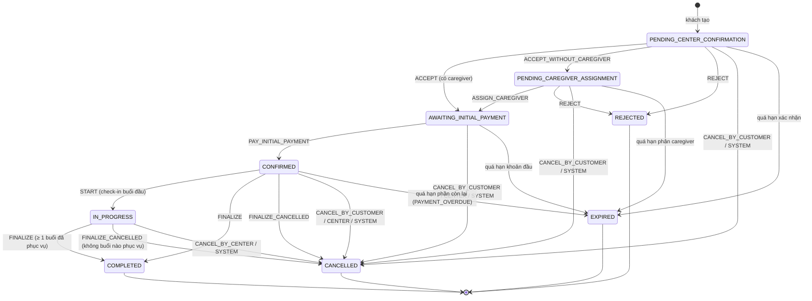
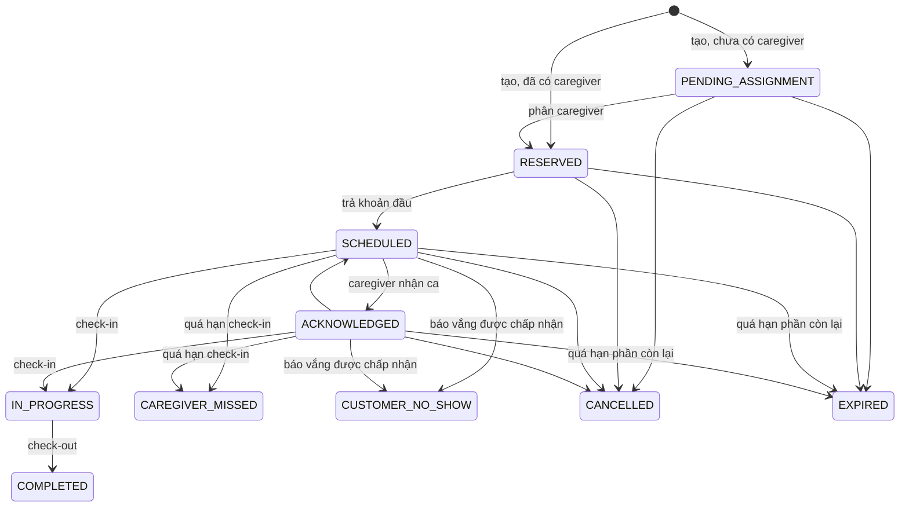
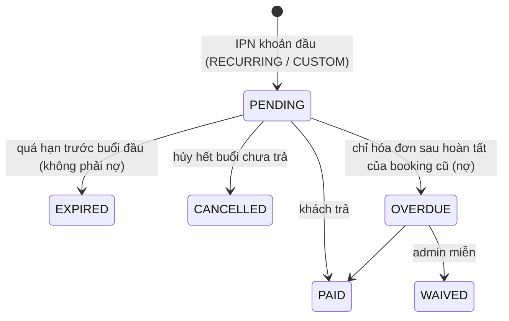
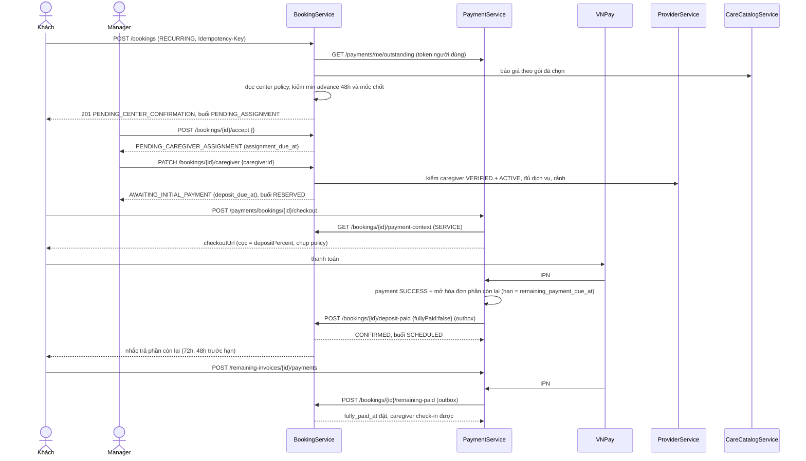
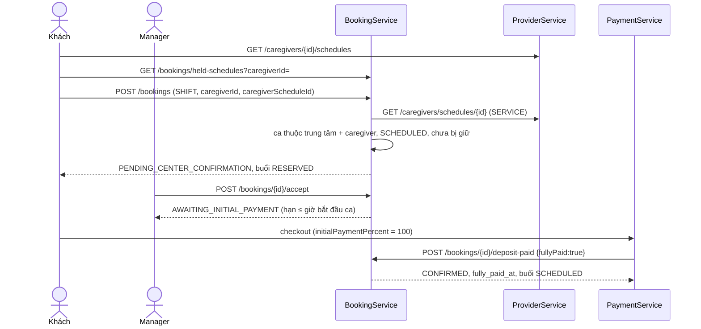

# Luồng Booking sau khi làm lại theo đặc tả v1.0 (2026-11-03)

> Đợt 6 (tài liệu) của nhiệm vụ làm lại booking theo `CareConnect_Booking_Business_Specification.docx` v1.0.
> Đây là tài liệu tham chiếu cho **trạng thái hiện tại của code** sau X1 và đợt 1–5. Lý do của từng quyết định và danh
> sách file đã sửa nằm ở `2026-11-02-BOOKING_FLOW_REVIEW.md` (gọi tắt **REVIEW**): §7 quyết định, §8.1 / §9.2 / §10.1
> thay đổi. Tiến độ: `2026-11-03-BOOKING_SPEC_V1_PROGRESS.md`.
>
> **Cập nhật 2026-11-03 — yêu cầu thay đổi v2** (`2026-11-03-BOOKING_CHANGE_REQUEST_V2.md`): booking có caregiver khách
> chọn đi qua `PENDING_CAREGIVER_CONFIRMATION` (caregiver tự nhận / từ chối) thay vì trung tâm duyệt; RECURRING nhận
> `slots` đã sửa; đổi địa chỉ chăm sóc; cọc bị giữ ghi cho caregiver của buổi. Phần dưới chưa viết lại theo các điểm này.
>
> Số "spec §x" là mục trong đặc tả. Mọi mốc thời gian lưu và truyền theo UTC (`Instant`); FE đổi sang giờ người dùng.

---

## 1. Tổng quan

| | |
|---|---|
| Service chính | **BookingService** (booking, buổi, ca chăm sóc, center booking policy, thông báo) |
| Service liên quan | **PaymentService** (khoản đầu, phần còn lại, hoàn tiền, doanh thu) · **ProviderService** (trung tâm, caregiver, lịch ca) · **CareCatalogService** (giá) · **CareRecipientService** (hồ sơ người bệnh) |
| Loại booking | `SHIFT` · `RECURRING` (`DAILY` / `WEEKLY`) · `CUSTOM` |
| Chính sách | `CenterBookingPolicy` theo từng trung tâm, lưu ở BookingService; trung tâm chưa cấu hình thì dùng mặc định từ env |
| Giao tiếp | Feign qua ApiGateway. Lời gọi không có người dùng (scheduler, outbox) dùng token `SERVICE` |

### 1.1 Ba loại booking (spec §4)

| | SHIFT | RECURRING | CUSTOM |
|---|---|---|---|
| Caregiver | **bắt buộc** | tùy chọn (trung tâm phân sau) | tùy chọn |
| Đầu vào lịch | `caregiverScheduleId` (ca caregiver đã công bố ở Provider) | `frequency`, `startDate`, `endDate`, `startTime`, `endTime`, `daysOfWeek` (chỉ WEEKLY) | `slots[{startAt, endAt}]`, mỗi buổi giờ riêng |
| Số buổi | 1 | sinh theo quy tắc | theo danh sách |
| Đặt trước tối thiểu (mặc định) | 2 giờ | 48 giờ | 48 giờ |
| Khoản thanh toán đầu | **100 %** | cọc `depositPercent` (mặc định 30 %) | cọc `depositPercent` |
| Phần còn lại | không có | trả trước buổi đầu `remainingPaymentDueBeforeMinutes` (mặc định 24 giờ) | như RECURRING |

Field lịch phải khớp loại booking, gửi thừa field của loại khác → 400 `5239`. Ràng buộc chung: tối đa 60 buổi, khoảng
ngày tối đa 90 ngày, buổi đầu trong 90 ngày tới (`5235`), mỗi buổi ≥ 1 giờ (`5236`), các buổi của một booking không
chồng giờ (`5240`, khoảng nửa mở `[startAt, endAt)`).

**Giá (spec §7.2, Q11).** Gói HOUR tính theo phút: số giờ = phút / 60 (90 phút = 1,5 giờ, lưu 4 chữ số thập phân để
hiển thị), tiền dòng = đơn giá × phút / 60, giá mỗi buổi làm tròn đến đồng. DAY và SHIFT tính 1 đơn vị mỗi buổi. Giá
chụp vào `booking_details` và từng buổi lúc tạo.

### 1.2 Mốc thời gian lưu trên booking

| Cột | Đặt lúc | Giá trị |
|---|---|---|
| `acceptance_due_at` | tạo booking | `min(now + confirmationTimeout, mốc chốt)` |
| `assignment_due_at` | xác nhận không caregiver | `min(now + assignmentTimeout, mốc chốt)` |
| `deposit_due_at` (hạn khoản đầu) | xác nhận có caregiver / phân caregiver | `min(now + initialPaymentTimeout, mốc chốt)` |
| `remaining_payment_due_at` | tạo booking (RECURRING / CUSTOM) | `buổi đầu − remainingPaymentDueBefore`; SHIFT là `NULL` |
| `confirmed_at` | trả khoản đầu | |
| `fully_paid_at` | **chỉ PaymentService đặt** | SHIFT: lúc trả khoản đầu; RECURRING / CUSTOM: lúc trả phần còn lại |

**Mốc chốt** = `remaining_payment_due_at` (RECURRING / CUSTOM) hoặc giờ buổi đầu (SHIFT). Lúc tạo, mốc chốt đã qua →
400 `5241 NO_VALID_PAYMENT_DEADLINE` (spec §8 "backend phải từ chối nếu không còn deadline hợp lệ").

---

## 2. Luồng theo vai trò

### 2.0 Chuẩn bị lịch caregiver (Provider, trước khi có booking SHIFT)

1. Manager tạo ca làm việc (`/center-manager/work-shifts`).
2. Caregiver đăng ký ca (mobile hoặc `/caregiver/work-shifts`).
3. Manager duyệt → ProviderService sinh `caregiver_schedules` (`SCHEDULED`). Mỗi lịch này là một "ca" khách có thể đặt SHIFT.

### 2.1 CUSTOMER

| Bước | Màn hình | API |
|---|---|---|
| Chọn trung tâm ACTIVE | header / form đặt lịch | `GET /care-centers/public` |
| Chọn dịch vụ + gói giá trước, rồi lọc caregiver có đủ dịch vụ (Q10) | `/customer/booking` | `GET /center-offerings…`, `GET /caregivers/search?careServiceIds=` |
| SHIFT: chọn ca của caregiver, ca đã bị giữ hiện khóa | `/customer/booking` | `GET /caregivers/{id}/schedules`, `GET /bookings/held-schedules` |
| Xem giá tạm tính + khoản đầu theo policy | sidebar form | `POST /bookings/quotes`, `GET /center-booking-policies/{centerId}` |
| Gửi đặt lịch (có `Idempotency-Key`) | | `POST /bookings` → `PENDING_CENTER_CONFIRMATION` |
| Trả khoản đầu khi trung tâm đã xác nhận | `/customer/bookings/:id/deposit` → VNPay | `POST /payments/bookings/{id}/checkout` |
| Trả phần còn lại trước hạn (RECURRING / CUSTOM) | chi tiết booking hoặc `/customer/payments` | `POST /remaining-invoices/{id}/payments` |
| Hủy cả booking hoặc từng buổi | chi tiết booking | `POST /bookings/{id}/cancellation-previews` rồi `POST /bookings/{id}/cancel` kèm `previewToken` |

Một khách giữ tối đa **3** booking chưa trả khoản đầu cùng lúc (`5228`). Có hóa đơn `OVERDUE` (nợ của booking cũ) thì
không đặt được booking mới.

### 2.2 CENTER_MANAGER (chỉ trung tâm trong token, trung tâm khác → 404)

| Việc | Trạng thái nguồn | API | Kết quả |
|---|---|---|---|
| Xác nhận, đã có caregiver (hoặc chọn caregiver lúc xác nhận) | `PENDING_CENTER_CONFIRMATION` | `POST /bookings/{id}/accept {caregiverId?}` | `AWAITING_INITIAL_PAYMENT` |
| Xác nhận, chưa có caregiver (RECURRING / CUSTOM) | `PENDING_CENTER_CONFIRMATION` | `POST /bookings/{id}/accept {}` | `PENDING_CAREGIVER_ASSIGNMENT` |
| Phân caregiver trong hạn | `PENDING_CAREGIVER_ASSIGNMENT` | `PATCH /bookings/{id}/caregiver` | `AWAITING_INITIAL_PAYMENT` |
| Đổi caregiver cả booking / một buổi chưa bắt đầu | còn giữ chỗ | `PATCH /bookings/{id}/caregiver`, `PATCH /bookings/{id}/occurrences/{oid}/caregiver` | buổi giữ trạng thái |
| Từ chối (kể cả không tìm được caregiver) | `PENDING_CENTER_CONFIRMATION`, `PENDING_CAREGIVER_ASSIGNMENT` | `POST /bookings/{id}/reject {reason}` | `REJECTED` |
| Hủy cả booking hoặc từng buổi đã trả tiền | `AWAITING_INITIAL_PAYMENT`, `CONFIRMED`, `IN_PROGRESS` | `POST /bookings/{id}/cancel {occurrenceIds?, reason}` | khách được hoàn 100 % |
| Quyết định báo khách vắng | buổi có báo vắng | `POST /booking-occurrences/{id}/no-show-reports/decision` | |
| Sửa chính sách đặt lịch | — | `/center-manager/policy` → `PUT /center-booking-policies/{centerId}` | |
| Xem doanh thu thuần của trung tâm | — | `/center-manager/statistics` → `GET /payments/revenue` | |

Xác nhận sau `acceptance_due_at` → 409 `5101` (booking sắp bị job hết hạn).

### 2.3 CAREGIVER (mobile)

- Chỉ thấy buổi của booking `CONFIRMED`, `IN_PROGRESS`, `COMPLETED`, `CANCELLED` (`GET /booking-occurrences`).
- Nhận ca: `POST /booking-occurrences/{id}/acknowledge` (buổi `SCHEDULED` → `ACKNOWLEDGED`).
- Check-in: `POST /care-sessions` trong cửa sổ check-in của booking — `start − checkInEarlyMinutes` tới `start + checkInLateMinutes`,
  chụp từ center policy lúc tạo, mặc định 30' / 30' (`5222`). Buổi trả `checkInOpensAt` / `checkInClosesAt` cho app. Booking RECURRING / CUSTOM chưa trả đủ →
  409 `5242`. Buổi chờ đổi người vì caregiver ngừng hoạt động → 409 `5234`.
- Trong ca: task, ghi chú; kết thúc `POST /care-sessions/{id}/end`; báo khách vắng `POST /booking-occurrences/{id}/no-show-reports`.

### 2.4 ADMIN

- Xem mọi booking (`/admin/bookings`), hủy thay nền tảng (hoàn 100 %). **Ngoài spec** (Q9), giữ theo D23, chờ xác nhận với người viết spec.
- Sửa chính sách đặt lịch của mọi trung tâm ACTIVE (`/admin/policies`).
- Xem doanh thu (`GET /payments/revenue?centerId=`). Trang `/admin/revenue` còn là mock (T13).

### 2.5 Hệ thống (scheduler / outbox)

| Job / sự kiện | Nơi chạy | Việc |
|---|---|---|
| `BookingExpiryScheduler` | Booking | Quá `acceptance_due_at` / `assignment_due_at` / `deposit_due_at` → `EXPIRE`; nhắc trả phần còn lại theo `remainingPaymentReminderMinutes` (mặc định 72h, 48h), mỗi mốc một lần |
| Job MISSED | Booking | Buổi `SCHEDULED` / `ACKNOWLEDGED` chưa check-in sau `start + checkInLateMinutes` của booking → `CAREGIVER_MISSED`, hoàn 100 % phần đã trả của buổi |
| Job quá hạn hóa đơn | **Payment** | Hóa đơn phần còn lại quá hạn → `EXPIRED`, giữ cọc theo `overduePaymentForfeitPercent`, hoàn phần dư, báo Booking `POST /bookings/{id}/payment-overdue` → booking `EXPIRED` |
| IPN VNPay khoản đầu | Payment → Booking | `POST /bookings/{id}/deposit-paid {fullyPaid}` (SHIFT `fullyPaid=true`); RECURRING / CUSTOM mở hóa đơn phần còn lại trong cùng transaction |
| IPN VNPay phần còn lại | Payment → Booking | `POST /bookings/{id}/remaining-paid` → `fully_paid_at` |
| Hủy / hết hạn có tiền | Booking → Payment (outbox) | `POST /refunds` |

---

## 3. State machine

Nguồn duy nhất: `BookingService/.../enums/BookingAction.java` (booking) và `OccurrenceStatus.canTransitionTo` (buổi).
Mọi chuyển trạng thái booking đi qua `BookingLifecycleService.apply`, trên booking đã khóa dòng, và ghi
`booking_status_history` (`from`, `to`, `changed_by`, `reason`, `changed_at`). Chuyển không hợp lệ → 409 `5101`.

### 3.1 Booking



| Hành động | Từ | Tới | Ai | Tác động lên buổi |
|---|---|---|---|---|
| `ACCEPT` | PENDING_CENTER_CONFIRMATION | AWAITING_INITIAL_PAYMENT | manager | đặt hạn khoản đầu |
| `ACCEPT_WITHOUT_CAREGIVER` | PENDING_CENTER_CONFIRMATION | PENDING_CAREGIVER_ASSIGNMENT | manager | đặt hạn phân công |
| `ASSIGN_CAREGIVER` | PENDING_CAREGIVER_ASSIGNMENT | AWAITING_INITIAL_PAYMENT | manager | `PENDING_ASSIGNMENT` → `RESERVED` |
| `REJECT` | PENDING_CENTER_CONFIRMATION, PENDING_CAREGIVER_ASSIGNMENT | REJECTED | manager | chưa bắt đầu → `CANCELLED` |
| `PAY_INITIAL_PAYMENT` | AWAITING_INITIAL_PAYMENT | CONFIRMED | Payment (SERVICE) | `RESERVED` → `SCHEDULED` (M2) |
| `CANCEL_BY_CUSTOMER` | 3 trạng thái chờ + CONFIRMED | CANCELLED | khách | chưa bắt đầu → `CANCELLED`, hoàn theo mốc |
| `CANCEL_BY_CENTER` | AWAITING_INITIAL_PAYMENT, CONFIRMED, IN_PROGRESS | CANCELLED | manager / admin | → `CANCELLED`, hoàn 100 % |
| `CANCEL_BY_SYSTEM` | mọi trạng thái còn giữ chỗ | CANCELLED | hệ thống (trung tâm bị khóa) | → `CANCELLED`, hoàn 100 % |
| `EXPIRE` | 3 trạng thái chờ + CONFIRMED | EXPIRED | scheduler / Payment | chưa bắt đầu → `EXPIRED`; không xếp hoàn tiền ở Booking |
| `START` | CONFIRMED | IN_PROGRESS | check-in buổi đầu | |
| `FINALIZE` | CONFIRMED, IN_PROGRESS | COMPLETED | hệ thống, khi hết buổi chưa kết thúc và ≥ 1 buổi `COMPLETED` / `CUSTOMER_NO_SHOW` (M5) | |
| `FINALIZE_CANCELLED` | CONFIRMED, IN_PROGRESS | CANCELLED | hệ thống, khi hết buổi chưa kết thúc và không buổi nào được phục vụ | |

Hủy **từng buổi** (`occurrenceIds`) không đổi trạng thái booking, trừ khi đó là các buổi cuối cùng (khi đó `FINALIZE` /
`FINALIZE_CANCELLED` chạy).

### 3.2 Buổi chăm sóc (occurrence)



| Tập | Trạng thái | Dùng cho |
|---|---|---|
| Chiếm lịch caregiver | RESERVED, SCHEDULED, ACKNOWLEDGED, IN_PROGRESS | exclusion constraint `ex_booking_occurrences_caregiver_slot` (409 `5215`) |
| Chưa kết thúc | PENDING_ASSIGNMENT + 4 trạng thái trên | trùng lịch người bệnh (`5216`), quyền xem hồ sơ |
| Chưa bắt đầu | PENDING_ASSIGNMENT, RESERVED, SCHEDULED, ACKNOWLEDGED | hủy, đổi caregiver |
| Làm việc được | SCHEDULED, ACKNOWLEDGED | nhận ca, check-in, báo vắng, MISSED |
| Kết thúc | COMPLETED, CANCELLED, EXPIRED, CUSTOMER_NO_SHOW, CAREGIVER_MISSED | |

Một lịch caregiver (SHIFT) chỉ có một buổi chiếm lịch: kiểm ở service và unique index
`uk_booking_occurrences_schedule_holding` → 409 `5411`.

### 3.3 Hóa đơn phần còn lại (PaymentService)



Hủy buổi khi hóa đơn còn `PENDING` thì số tiền hóa đơn giảm; về 0 thì `CANCELLED`.

---

## 4. Sơ đồ tuần tự

### 4.1 RECURRING chưa có caregiver: tạo → xác nhận → phân công → khoản đầu → phần còn lại



### 4.2 SHIFT: một ca, trả 100 %



### 4.3 Quá hạn trả phần còn lại

```mermaid
sequenceDiagram
    participant P as PaymentService
    participant B as BookingService
    actor C as Khách
    actor Cg as Caregiver / Manager

    P->>P: job: hóa đơn PENDING quá hạn → khóa dòng hóa đơn
    P->>P: hóa đơn EXPIRED; giữ overduePaymentForfeitPercent của cọc; hoàn phần dư (PAYMENT_OVERDUE)
    P->>B: POST /bookings/{id}/payment-overdue (outbox, idempotent)
    B->>B: EXPIRE: CONFIRMED → EXPIRED, buổi → EXPIRED, lý do PAYMENT_OVERDUE, giải phóng caregiver
    B-->>C: thông báo
    B-->>Cg: thông báo
```

Khách trả phiên cũ sau khi hóa đơn đã `EXPIRED` → Payment hoàn lại khoản vừa thu.

### 4.4 Hủy một buổi đã trả tiền

```mermaid
sequenceDiagram
    actor C as Khách
    participant B as BookingService
    participant P as PaymentService

    C->>B: POST /bookings/{id}/cancellation-previews {occurrenceIds}
    B->>P: POST /refund-quotes (SERVICE)
    P-->>B: số hoàn theo mốc (BEFORE_THRESHOLD 100 % / AFTER_THRESHOLD 70 % số đã trả của buổi)
    B-->>C: preview + previewToken
    C->>B: POST /bookings/{id}/cancel {occurrenceIds, previewToken}
    B->>B: buổi → CANCELLED; số tính lại khác preview → 409, FE hỏi lại
    B->>P: POST /refunds (outbox)
    P->>P: hoàn chia qua REMAINING rồi DEPOSIT; hóa đơn PENDING giảm hoặc CANCELLED
```

Manager / admin hủy cùng API, không cần preview, khách được hoàn 100 %.

---

## 5. API contract

Mọi path qua gateway, tiền tố `/api/v1`. Response bọc `APIResponse<T>` (`code`, `message`, `result`). Phạm vi dữ liệu
lấy từ token; ngoài phạm vi → 404.

### 5.1 BookingService

| Method + path | Role | Ghi chú |
|---|---|---|
| `GET /bookings` | CUSTOMER, CENTER_MANAGER, ADMIN | lọc theo status, ngày, từ khóa; phân trang |
| `GET /bookings/held-schedules?caregiverId&from&to` | CUSTOMER, CENTER_MANAGER, ADMIN | id ca đang bị giữ, không lộ booking người khác |
| `GET /bookings/{id}` | CUSTOMER, CENTER_MANAGER, ADMIN | có `bookingType`, các hạn, `initialPaymentPercent`, `fullyPaidAt` |
| `GET /bookings/{id}/history` · `/occurrences` | CUSTOMER, CENTER_MANAGER, ADMIN | |
| `POST /bookings` | CUSTOMER | header `Idempotency-Key`; body §5.3 |
| `POST /bookings/quotes` | CUSTOMER | cùng body, không lưu |
| `POST /bookings/{id}/cancellation-previews` | CUSTOMER | `{occurrenceIds?}` |
| `POST /bookings/{id}/cancel` | CUSTOMER, CENTER_MANAGER, ADMIN | `{occurrenceIds?, reason, previewToken?}`; `occurrenceIds` rỗng = mọi buổi chưa bắt đầu |
| `POST /bookings/{id}/accept` | CENTER_MANAGER | `{caregiverId?}` |
| `POST /bookings/{id}/reject` | CENTER_MANAGER | `{reason}` |
| `PATCH /bookings/{id}/caregiver` | CENTER_MANAGER | `{caregiverId}` — phân công hoặc đổi người |
| `PATCH /bookings/{id}/occurrences/{oid}/caregiver` | CENTER_MANAGER | đổi người cho một buổi |
| `GET /bookings/{id}/payment-context` | SERVICE | `bookingType`, `initialPaymentPercent`, `remainingPaymentDueAt`, mốc / % hoàn, % giữ cọc |
| `POST /bookings/{id}/deposit-paid` | SERVICE | `{paymentReference, fullyPaid}`; idempotent |
| `POST /bookings/{id}/remaining-paid` | SERVICE | idempotent |
| `POST /bookings/{id}/payment-overdue` | SERVICE | idempotent |
| `POST /bookings/system-cancellations` | SERVICE | trung tâm bị khóa / caregiver ngừng hoạt động |
| `GET /center-booking-policies/{centerId}` | CUSTOMER, CENTER_MANAGER (trung tâm mình), ADMIN | chưa có policy riêng → mặc định, `version = null` |
| `PUT /center-booking-policies/{centerId}` | CENTER_MANAGER (trung tâm mình), ADMIN | thay toàn bộ; `version` lệch → 409 `5006` |
| `GET /booking-occurrences` · `POST /{id}/acknowledge` · `POST /{id}/no-show-reports` | CAREGIVER | |
| `POST /booking-occurrences/{id}/no-show-reports/decision` | CENTER_MANAGER | |
| `POST /care-sessions` · `/{id}/end` · tasks / notes | CAREGIVER | check-in cần trả đủ (`5242`) |

### 5.2 PaymentService và ProviderService (phần booking dùng)

| Method + path | Role | Ghi chú |
|---|---|---|
| `POST /payments/bookings/{bookingId}/checkout` | CUSTOMER | `{provider: VNPAY}`; số tiền do server tính |
| `GET /payments/vnpay/ipn` | public (chữ ký VNPay) | trả JSON chuẩn VNPay |
| `GET /payments/me/outstanding` | CUSTOMER | nợ `OVERDUE` chặn đặt lịch |
| `GET /payments/revenue` | ADMIN (`centerId` tùy chọn), CENTER_MANAGER (trung tâm trong token) | đã thu, đã hoàn, số giao dịch |
| `GET /remaining-invoices` · `POST /{id}/payments` | CUSTOMER | phiên chỉ mở tới hạn |
| `POST /refund-quotes` · `POST /refunds` | SERVICE | |
| `GET /caregivers/{id}/schedules?from&to` (Provider) | đã đăng nhập | chỉ caregiver VERIFIED + ACTIVE của trung tâm ACTIVE |
| `GET /caregivers/schedules/{id}` (Provider) | SERVICE, ADMIN | Booking xác minh SHIFT |

### 5.3 Body tạo booking

```json
{
  "recipientId": "uuid", "centerId": "uuid",
  "bookingType": "SHIFT | RECURRING | CUSTOM",
  "caregiverId": "uuid (SHIFT bắt buộc)",
  "caregiverScheduleId": "uuid (chỉ SHIFT)",
  "frequency": "DAILY | WEEKLY", "startDate": "2026-11-20", "endDate": "2026-12-20",
  "startTime": "08:00", "endTime": "12:00", "daysOfWeek": [1, 3, 5],
  "slots": [{ "startAt": "2026-11-20T01:00:00Z", "endAt": "2026-11-20T05:00:00Z" }],
  "customerNote": "…",
  "services": [{ "careServiceId": "uuid", "centerServiceId": "uuid", "pricePlanId": "uuid" }]
}
```

Chỉ gửi nhóm field của loại đã chọn. `userId` / `customerId` không có trong body (lấy từ token); field lạ → 400.

### 5.4 Center booking policy (spec §8)

| Trường (phút / %) | Mặc định | Giới hạn |
|---|---|---|
| `shiftMinAdvanceMinutes` | 120 | 0–43200 |
| `recurringMinAdvanceMinutes` · `customMinAdvanceMinutes` | 2880 | 0–43200 |
| `confirmationTimeoutMinutes` · `assignmentTimeoutMinutes` · `initialPaymentTimeoutMinutes` | 1440 | 1–43200 |
| `remainingPaymentDueBeforeMinutes` | 1440 | 0–43200 |
| `remainingPaymentReminderMinutes` | [4320, 2880] | ≤ 5 mốc, không trùng |
| `depositPercent` | 30 | 1–100 |
| `checkInEarlyMinutes` · `checkInLateMinutes` | 30 · 30 | 0–1440 — chụp vào booking lúc tạo, quyết định cửa sổ check-in, hạn báo vắng và mốc MISSED (Q12) |
| `refundThresholdMinutes` | 1440 | |
| `refundPercentBeforeThreshold` · `refundPercentAfterThreshold` | 100 · 70 | sau mốc ≤ trước mốc |
| `overduePaymentForfeitPercent` | 100 | |

Ràng buộc chéo (400 `5413`): đặt trước RECURRING / CUSTOM phải **lớn hơn** hạn trả phần còn lại. FE còn cảnh báo
(không chặn) khi hạn xác nhận + phân công + thanh toán không vừa khoảng đặt trước tối thiểu. Mặc định đọc từ env
`BOOKING_POLICY_*`. Payment chụp policy vào `policy_snapshot` lúc mở phiên thanh toán đầu, nên sửa policy sau đó không
làm đổi tiền của booking đã trả.

### 5.5 Mã lỗi thường gặp trong luồng

| Mã | HTTP | Ý nghĩa |
|---|---|---|
| 5101 | 409 | Chuyển trạng thái không hợp lệ (kể cả xác nhận sau hạn) |
| 5102 | 409 | `Idempotency-Key` đã dùng cho một yêu cầu khác |
| 5006 | 409 | Policy vừa bị người khác sửa |
| 5200 / 5237 / 5238 / 5239 | 400 | Thiếu loại booking / thiếu ca SHIFT / thiếu tần suất / field không khớp loại |
| 5214 | 400 | Buổi đầu sớm hơn đặt trước tối thiểu |
| 5240 | 400 | Các buổi CUSTOM chồng giờ |
| 5241 | 400 | Không còn đủ thời gian để xác nhận và thanh toán |
| 5215 / 5216 | 409 | Caregiver / người bệnh trùng lịch |
| 5228 | 409 | Quá 3 booking đang chờ |
| 5242 | 409 | Check-in khi chưa trả đủ |
| 5409 / 5410 / 5411 | 404 / 400 / 409 | Ca SHIFT không tồn tại / không thuộc trung tâm + caregiver / đã bị giữ |
| 5404 / 5405 / 5406 / 5408 | 409 / 409 / 400 / 409 | Caregiver chưa xác minh / không hoạt động / thiếu dịch vụ; trung tâm không nhận booking |
| 5413 / 5414 | 400 | Policy sai / thiếu giá trị |

---

## 6. Edge case (spec §15 và phát sinh khi làm)

| Tình huống | Hành vi hiện tại |
|---|---|
| Hai khách đặt cùng một ca / giờ cùng lúc | Advisory lock caregiver → người bệnh; unique index ca SHIFT (`5411`); exclusion constraint giờ caregiver (`5215`). Chỉ một booking thành công |
| Gửi lại `POST /bookings` cùng `Idempotency-Key` | Trả booking đã tạo; cùng key khác body → 409 `5102` |
| Caregiver bị khóa / ngừng hoạt động trước khi xác nhận | Xác nhận với người đó bị từ chối (`5405`); RECURRING / CUSTOM xác nhận không caregiver rồi phân người khác |
| Caregiver ngừng hoạt động khi đã có buổi sắp tới | Provider báo qua outbox → buổi gắn cờ `needsReassignment`, báo manager + khách; caregiver cũ không check-in được (`5234`) |
| Trung tâm bị khóa (SUSPENDED) | `system-cancellations` hủy booking còn giữ chỗ, hoàn 100 % |
| Giá đổi sau khi tạo booking | Booking giữ snapshot giá ở `booking_details` và từng buổi |
| Policy đổi sau khi khách đã trả khoản đầu | Payment dùng `policy_snapshot`; hạn trên booking không tính lại |
| Quá hạn xác nhận / phân công / khoản đầu | `EXPIRED`, buổi `EXPIRED`, giải phóng lịch; chưa có tiền nên không hoàn |
| Quá hạn phần còn lại | Payment giữ cọc theo `overduePaymentForfeitPercent`, hoàn phần dư; booking `EXPIRED` lý do `PAYMENT_OVERDUE` |
| Khách vừa trả đúng lúc hóa đơn quá hạn | Job quá hạn và IPN khóa cùng dòng hóa đơn: trả trước thì không quá hạn; trả sau thì khoản đó được hoàn |
| IPN / outbox gửi lặp | `deposit-paid`, `remaining-paid`, `payment-overdue` idempotent; IPN VNPay idempotent |
| Booking tạo sát giờ, mốc nhắc 72h đã qua | Bỏ qua mốc đã qua, không nhắc dồn |
| Kết quả hoàn khi hủy khác lúc preview | 409, FE hỏi lại khách |
| Hủy buổi sau khi đã trả đủ | Hoàn chia qua payment REMAINING rồi DEPOSIT; tổng hoàn không vượt số còn hoàn được |
| Hủy hết buổi còn lại khi đã có buổi diễn ra | Booking `COMPLETED`, buổi bị hủy ghi ở cấp buổi (M5) |
| `userId` / `centerId` gửi trong body | Field lạ → 400; phạm vi lấy từ token |
| Booking cũ trước migration (`remaining_payment_due_at` NULL) | Giữ quy tắc cũ: hóa đơn sau hoàn tất, có thể thành nợ `OVERDUE` |

---

## 7. Hướng dẫn test thủ công

### 7.1 Chuẩn bị

1. Áp change script hoặc reset DB (REVIEW §8.3, §9.4): Booking `2026-11-02_booking_spec_v1.sql` rồi
   `2026-11-02_booking_spec_v1_payment.sql` rồi `2026-11-03_booking_spec_v1_q11_q12.sql`; Payment
   `2026-11-02-payment-spec-v1.sql`.
2. `BE/PaymentService/.env`: `PAYMENT_JWT_ISSUER` bằng `IDENTITY_JWT_ISSUER` (X1).
3. Build lại và restart booking-service, payment-service, provider-service, api-gateway (`BE/start.bat`). Chạy FE `pnpm dev`.
4. Dữ liệu: một trung tâm ACTIVE có manager; ≥ 2 caregiver VERIFIED + ACTIVE đã gán dịch vụ; dịch vụ trung tâm có gói
   giá theo giờ; một khách có hồ sơ người bệnh. Để dễ thử, manager vào `/center-manager/policy` giảm đặt trước
   RECURRING / CUSTOM xuống vài giờ (vẫn lớn hơn hạn trả phần còn lại).
5. VNPay sandbox: dùng thẻ test của VNPay.

### 7.2 Kịch bản

| # | Kịch bản | Thao tác | Kết quả mong đợi |
|---|---|---|---|
| 1 | SHIFT trả 100 % | Manager tạo ca, caregiver đăng ký, manager duyệt. Khách đặt SHIFT ca đó → manager xác nhận → khách trả | Trang thanh toán ghi "toàn bộ giá trị". Sau IPN: booking `CONFIRMED`, chi tiết hiện "Đã thanh toán đủ", buổi `SCHEDULED` |
| 2 | Ca đã bị giữ | Khách thứ hai mở cùng caregiver | Ca ở kịch bản 1 hiện khóa; gọi API thẳng → 409 `5411` |
| 3 | RECURRING không caregiver | Khách đặt WEEKLY không chọn người → manager "Xác nhận" không chọn → "Phân người chăm sóc" | `PENDING_CAREGIVER_ASSIGNMENT` rồi `AWAITING_INITIAL_PAYMENT`; buổi `PENDING_ASSIGNMENT` → `RESERVED` |
| 4 | Cọc + phần còn lại | Tiếp kịch bản 3: khách trả cọc, sau đó bấm "Thanh toán phần còn lại" trên chi tiết booking | Sau cọc: `CONFIRMED`, hiện số và hạn phần còn lại; caregiver check-in bị chặn `5242`. Sau khi trả: "Đã thanh toán đủ", check-in được |
| 5 | CUSTOM chồng giờ | Thêm hai buổi giao nhau | Form chặn; gọi API thẳng → 400 `5240` |
| 6 | Đặt sát giờ | RECURRING bắt đầu sớm hơn đặt trước tối thiểu | 400 `5214` |
| 7 | Quá hạn xác nhận | Policy hạn xác nhận 1 phút, không xác nhận | Sau chu kỳ scheduler: `EXPIRED`, buổi `EXPIRED`, ca được giải phóng |
| 8 | Quá hạn phần còn lại | Policy hạn trả nốt gần buổi đầu; trả cọc rồi không trả nốt | Hóa đơn `EXPIRED` (không thành nợ), cọc bị giữ theo %, booking `EXPIRED` lý do `PAYMENT_OVERDUE`, khách vẫn đặt lịch mới được |
| 9 | Khách hủy một buổi | Booking đã trả, hủy 1 buổi còn ≥ 24h và 1 buổi < 24h | Preview: 100 % và 70 % số đã trả của buổi; buổi `CANCELLED`, refund tạo ở Payment |
| 10 | Manager hủy một buổi | `/center-manager/bookings/:id` hủy một buổi đã trả | Khách được hoàn 100 % |
| 11 | Policy | Manager sửa policy với hoàn sau mốc > trước mốc; mở hai tab rồi lưu cả hai | 400 `5413` hiện ở form; tab lưu sau báo 409 "vừa được cập nhật" |
| 12 | Phạm vi | Manager trung tâm A mở booking / policy của trung tâm B | 404 |
| 13 | Doanh thu | `/center-manager/statistics` sau kịch bản 1, 4, 9 | Đã thu, đã hoàn khớp các giao dịch |
| 14 | Mobile caregiver | Lọc "Bỏ lỡ", xem buổi `CAREGIVER_MISSED` / `EXPIRED` | Nhãn đúng, không hiện key thô |
| 15 | Giờ lẻ (Q11) | Đặt CUSTOM một buổi 90 phút, gói 100.000đ / giờ | Báo giá 150.000đ, 1,5 giờ |
| 16 | Cửa sổ check-in theo policy (Q12) | Policy check-in sớm 60', trễ 10'; đặt và trả xong; mở buổi trên app caregiver 50' trước giờ hẹn, rồi 15' sau giờ hẹn | Trước giờ: nút bắt đầu bật. Sau 10': nút tắt, buổi thành `CAREGIVER_MISSED` ở lượt quét kế tiếp. Booking tạo trước khi đổi policy giữ cửa sổ cũ |

---

## 8. Tồn đọng tổng hợp và câu hỏi còn mở

| # | Nội dung | Chờ |
|---|---|---|
| T6 / G15 | Lịch tháng chỉ vẽ booking CUSTOM ở ngày đầu | duyệt G15 |
| T10 / G19 | Hóa đơn giảm khi khách đang mở phiên trả số cũ → phần dư không tự hoàn | duyệt G19 |
| T11 / G20 | Thứ tự khóa khác nhau giữa lệnh hoàn và IPN → deadlock hiếm | duyệt G20 |
| T12, T15 / G21 | `platform_policies` và `GET /payment-policies/effective` không còn dùng để tính tiền | duyệt G21 |
| T13 / G25 | `/admin/revenue` còn là mock | duyệt G25 |
| T14 / G24 | FE tìm hóa đơn của booking trong 100 hóa đơn chờ đầu tiên | duyệt G24 |
| Q9, Q10, M3 | Admin hủy booking (đang giữ: hoàn 100 %); thứ tự chọn caregiver ↔ dịch vụ (đang: dịch vụ trước); mất cọc khi quá hạn (đang: theo `overduePaymentForfeitPercent`, mặc định 100 %) | xác nhận với người viết spec |
| E2E | Chưa chạy luồng thật trên trình duyệt | chủ dự án áp change script và build lại |
